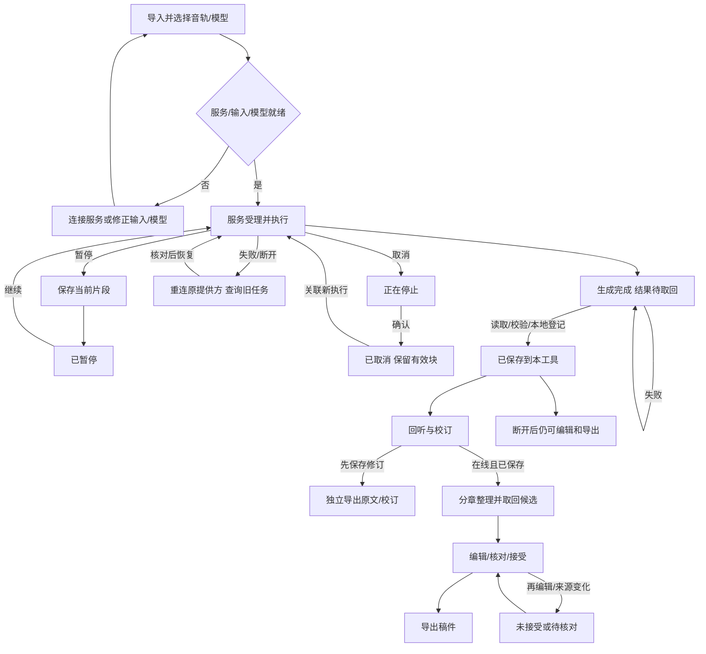

# Any2Text UI 与交互规范

规范、原型与图纸版本 **v0.4**，2026-11-12。状态：BGX 6.0.0 / BGX333 已审核的拟议设计，业务待实施。配套：[开发计划](../plans/20261112-PLAN-any2text.md)、[可点击原型](any2text-ui.html)、[交互总图 SVG](any2text-flow.svg) / [PNG](any2text-flow.png)。服务、身份和持久化合同以开发计划 §2～3 为权威。

原型为自包含 HTML/CSS/JavaScript，可本地打开，不访问网络或模型。媒体、任务、六段字幕和生成稿均为示例；播放仅演示定位。原型“保存”只保存在页面内，刷新即重置；下载只导出带示例标记的文稿。产品正式持久化和两小时能力不能由原型推断。

## 1. 信息架构与布局原则

Any2Text 随比格熊发布，识别和整理调用默认 BigBear 服务。客户端不安装/运行第二套 ASR；已取回文稿、校订、版本与导出由客户端保存，服务断开后仍可使用。

以产品设计师、用户体验专家的角度组织工作：用户先看任务与内容，再看设置；主操作靠近输入/结果。删除大面积说明、重复卡片、开发注释和无依据的装饰控件。技术合同与设计理由留在本文；必要的范围、版本、失败原因与下一步就近显示，不为紧凑隐藏关键功能。

五个稳定入口：U01 导入素材、U02 任务队列、U03 字幕校对、U04 整理成稿、U05 导出交付。桌面侧栏 152px（小桌面 130px）、顶栏 50px，正文以 14px 字体与 36px 以上按钮为基础，卡片间距 14px，不使用巨型标题。顶栏展示素材与服务状态，演示说明收在一处可展开标识。

1440×900 与 1024×768 为桌面目标；小于 850px 时导航转顶部换行、内容转单列。文本区域保留阅读宽度，原文按需展开，字幕列表单独滚动；不能依靠缩小字号消除溢出。键盘焦点可见，选中状态同时有文字/边框，不只靠颜色。

点击顶栏服务状态打开连接面板，默认收起。真实产品显示兼容版本、连接/断开与前往提供方模型设置，只有验证后才能声明就绪。不显示未实现的其他厂商为可用。断开在途任务时选择请求取消或保留任务；未确认取消为待核对，不能把断开等同取消或退出主程序。已经生成的待取回结果只提示重连取回，不提供无效的运行取消动作。旧任务固定所属提供方，不转交新提供方；缺服务仅阻止新识别、整理和取回，已有本地文稿继续可用。

原型模拟连接、断开与待核对；版本握手、模型设置跳转、第二适配器和原生服务启动均未实现。连接面板是设计演示，不能显示为已连接真实主程序。

## 2. 页面与行为

### U01 导入素材

左侧选取素材与文件信息，右侧设置音轨、模型、语言和“开始转写”。真实产品需拖入/选择文件并探测时长、音轨及可解码状态；多音轨明确选择，不隐藏。时间粒度由提供方实际能力决定，缺模型/未连接/输入失效阻断提交，并给准备或修正动作。

模型目录、安装和就绪由提供方管理。BigBear 适配器指向比格熊模型管理，客户端列出提供方返回的本地语音识别配置及其就绪状态，保留多个可用模型供用户选择。提交采用所选配置 ID，不从显示名猜能力。配置不可用时显示原因，禁止静默换模型。受理前冻结参数，修改设置仅影响新任务。云端整理密钥不阻挡已可用的本地转写。

原型入口叫“载入示例素材”，不伪装真实文件探测。可切换示例模型观察阻断；载入的是两小时素材的显示数据，实际字幕仅六段。支持格式最终按 PLAN §1 实测声明。

### U02 任务队列

左侧当前任务状态、源时长进度和操作，右侧紧凑队列。“服务已提交片段”与“已保存到本工具”分开。未稳定测得吞吐时显示“正在估算”；源时长不能冒充墙钟耗时。

暂停先进入“正在保存当前片段”，提交后为“已暂停”；取消先进入“正在停止任务”，确认后为“已取消”，不删除原媒体或已提交成果。继续未完成部分只复用原提供方、同输入/模型/参数的有效检查点；已取消旧 attempt 保持终态，新执行关联旧进度。模型切换/输入变化创建新结果版本，不能混合不同语义。

断开后展示“状态待核对”，重新连接先查原任务，不能自动重新生成或重复计费。服务生成结束显示“结果待取回”；成功读取、原子保存并登记本地修订后才显示“已保存到本工具”。取回失败重试取回，不重做识别。过程见 A02。

可打开已经落盘的本地文稿。若产品支持分块取回，只有已取回范围可编辑，并标明范围；原型始终使用预存六段样例，不能将服务模拟进度当作新字幕已落盘。状态模拟按钮收在“演示状态”中，不以计时器假装真实运行。

### U03 字幕校对

左侧紧凑定位播放器与字幕列表，右侧当前句编辑器；页内工具栏放“导出字幕”“整理成稿”。波形只占 42px，搜索紧邻字幕，不增加第三个重复说明栏；识别原文按需展开。默认桌面保存动作位于首屏，窄窗按定位、列表、编辑顺序排列。

点击字幕或搜索结果定位原音时间，不重新识别。原文只读，校订另存，明确未保存/保存中/已保存/保存失败；失败保留输入。真实保存采用 expectedRevision，避免并发覆盖和轮询打断输入法。合并拆分若后续纳入，需保留时间来源；无单元时间不能伪造逐字时间，本原型不放无实现的拆分按钮。

有未保存校订时，整理和校订导出要求先保存；允许单独导出只读原文。来源修订变化使既有候选待核对，不静默替换。原型覆盖六段的选择、搜索、前后定位、修改和保存；不播放真实音视频。

### U04 整理成稿

左侧宽候选编辑器与口播稿/文学剧本切换；右侧设置和来源引用，共两栏。主动作是生成/重新生成，候选下方接受；接受后可导出。剧本选择忠实整理或创作改编，新增/推测明确标注；费用与模型信息只在真实提供方可确定时展示。

真实生成冻结已保存校订修订，显示所用版本与覆盖范围；两小时文本按章节处理。未保存校订不能用于生成、接受和最终导出。来源引用返回对应字幕段；候选不覆盖原始转写，接受只保存客户端稿件版本，不直接应用到比格熊创作。

候选人工编辑后立即撤销接受，来源版本变化阻断旧稿直接接受或导出；保留旧候选供比较。生成失败保留原文与完成章节，重试失败章节；截断/漏段不能标完整，有意缩写另行表示。稿件先取回落盘再接受，状态合同沿用 A02/A03。

原型生成预置候选，演示类型切换、创作标记、来源、编辑与接受；不是文本模型或分章恢复验证。离线时禁止新生成，已保存稿件可编辑、接受和导出。

### U05 导出交付

左侧来源/格式/范围与下载，右侧内容预览。先选校订字幕、只读识别原文或已接受的稿件；校订与原文不能共用一份已修改文本。字幕支持 SRT/VTT/TXT/JSON；稿件仅 TXT/Markdown，不继承原音时间，制作字幕需新配音对齐。

导出检查范围、修订、文件名和目标目录。正式产品写成功才显示实际路径与打开操作；失败保留正文可换目录，不重新生成。断开、停用或卸载提供方不影响已取回文稿；媒体路径失效仅影响回听，应允许重定位。未取回结果需原提供方在线。

“发送到比格熊创作”是可选扩展，只有服务握手与接收目标可选后启用，导入候选而非直接改正式对象；重发幂等。原型按钮禁用，不伪报成功。示例下载文件名带“示例”，TXT/Markdown、JSON、VTT 带演示内容标识；SRT 保持格式标准，在界面和文件名明确样例范围。

## 3. 关键交互状态

图内自循环只表示取回重试，不表示无限自动重试。受理回执丢失、原子文件发布与登记的崩溃窗口、旧 attempt 迟到结果详见 PLAN §3 和 A02，不另造第二份合同。

## 4. 交互验收

- 未连接或缺模型禁止新提交；取消/暂停的等待状态与最终确认分开，已提交进度不归零。
- 服务成功不等于客户端保存；断开后的取消为待核对，完成任务不提供取消运行；本地已有文稿离线可用。
- 源时长与真实耗时分开，所有原型进度是演示；结果范围与当前服务进度不混淆。
- 搜索与字幕定位一致，校订显式保存，未保存修改阻止生成/校订导出；原文独立、只读且可导出。
- 候选不覆盖原文；编辑已接受稿撤销接受，来源变化阻断旧稿；创作新增标记可见，改写稿无 SRT/VTT。
- 真实发送未接通保持禁用；示例下载可读取并有明确演示标记。
- 1440/1024/736/360 四档宽度五页无横向溢出；1024×768 可见校对保存动作；键盘能从编辑器到保存。

上述为验收要求；本次实际验证范围与未模拟部分以 §5 为准。

## 5. 本轮验证与边界

2026-11-12 14:23 +08:00 使用已有 Playwright 和本机 Edge 无头浏览器执行 [verify-prototype.cjs](verify-prototype.cjs)，约 4.5 秒，**53 项断言通过**：[原始结果 JSON](prototype-validation.json)。使用现有 Node 环境并令 NODE_PATH 指向已安装 Playwright 后运行 `node docs/design/verify-prototype.cjs`；BGX_BROWSER 可指定已有 Chromium/Edge 可执行路径。未安装依赖。

覆盖模型阻断、暂停待提交、取消待确认、失败/中断继续、结果待取回、断开阻断新任务/取回、已有文稿离线导出、取消后断开待核对、重连后确认；搜索、定位、未保存保护、原文/校订分离、候选接受失效、创作标记、稿件格式和实际示例文本下载。四档宽度共 20 次页面溢出检查，桌面保存可见、键盘焦点可达；无 JavaScript 错误、无 HTTP(S) 请求。已目视核对五页、连接面板、浅/深色、窄窗及四张图的渲染。

本轮界面变化前的 43 项、提供方补充过程的 49 项检查仅为中间结果；当前原型以 53 项记录为准。没有业务运行验收，不能把“保存”“取消”模拟转换成真实磁盘或进程证据。部分结果取回、版本握手、服务授权/能力声明、失败章节恢复、冲突保存、素材重定位和第二提供方替换未完整模拟，实施时仍须按 T00～T06 验收。

真实音视频播放、媒体探测、模型质量、持久化/崩溃恢复、两小时性能、Tauri 原生窗口、联合安装和用户端入口均 **NOT_RUN**。本轮不更改比格熊源码，不提交真实任务，不重构业务内核；原型直接打开或刷新即可查看，不需要重装产品。

历史说明：v0.2 曾修正窄屏波形撑开布局、候选编辑后仍显示接受，以及 SVG 直接打开截图超时；v0.3 只完善服务所有权文档，原型未跟进。本次 v0.4 补齐这一差距。历史记录保留在快照中，旧验证不代替本次或未来服务验收。

## 6. 图纸、预览与后续修订

以下为同一组 **v0.4 / 2026-11-12 / 拟议设计，未实施** 资料；PNG 由对应 SVG 或 HTML 渲染。详细合同不复制进图源，修改时沿 PLAN / 本规范定位对应章节。

- **A01 架构与归属**：[SVG](any2text-architecture.svg) / [PNG](any2text-architecture.png)。R04/R05；PLAN §2～3；T01/T03/T06。
- **A02 受理、恢复与取回**：[SVG](any2text-lifecycle.svg) / [PNG](any2text-lifecycle.png)。R01/R02/R05；PLAN §3.1/3.3/3.4；T00/T02/T03/T06。
- **A03 修订与提供方替换**：[SVG](any2text-revisions.svg) / [PNG](any2text-revisions.png)。R03/R05；PLAN §3.2～3.4；T03/T04/T05/T06。
- **U01～U05 交互总图**：[SVG](any2text-flow.svg) / [PNG](any2text-flow.png)；[HTML 图源及可点击原型](any2text-ui.html)。R01～R05；本文 §1～4；T03/T05/T06。总图是流程示意，页面布局以 HTML 为准。
- 页面图片：[导入](any2text-ui-import.png)、[队列](any2text-ui-tasks.png)、[校对](any2text-ui-preview.png)、[整理](any2text-ui-write.png)、[导出](any2text-ui-export.png)、[服务连接/断开](any2text-ui-provider.png)。校对补充：[深色 1024×768](any2text-ui-dark-preview.png)、[窄窗](any2text-ui-narrow.png)。

后期修改继续改这些原文件：界面改 HTML 与受影响页面预览；流程/架构改对应 SVG、PNG 与 PLAN 合同/任务。递增设计版本，只重验受影响行为；实现进度必须另有实际证据才能标已实现，不自动将图纸变成业务事实。

[旧 v0.2 设计快照](history/any2text-design-v0.2.zip)和[v0.3 计划快照](history/any2text-plan-v0.3.zip)仅用于回溯，已由当前版本替代。README 为当前入口，不另立重复图纸台账。
