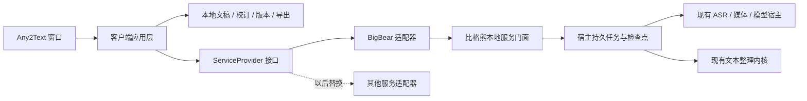

# Any2Text 创作辅助客户端开发计划

版本：v0.4。创建及更新日期：2026-11-12，Asia/Shanghai。状态：**T00 已验证本机 Bridge 连通，短样本转写受阻；详见 T00 执行记录**。

Any2Text 随比格熊一起发布，作为音视频转字幕、原文、口播稿与文学剧本的辅助客户端。默认调用比格熊服务，不复制 ASR、模型管理和文本生成内核。客户端通过可替换的服务接口访问能力，已取回成果由客户端独立保存。1～2 小时媒体仍是首版正式验收对象。

配套：[UI 规范](../design/20261112-UI-any2text.md)、[交互原型](../design/any2text-ui.html)、[操作总图](../design/any2text-flow.svg)。计划、图纸与原型统一为 v0.4；图纸为拟议设计，原型为演示，不是运行事实。本文是现行实施权威。

## 1. 用户决定与需求范围

2026-11-12 用户在审核中明确：工具大概率随比格熊一起发布，服务依赖可以接受；两边可配合，避免维护两套 ASR；架构应允许停止使用比格熊、改用其他服务提供方。

此决定替代 v0.2 的“Any2Text 自带独立推理服务、以后由 ai-story 反向消费”方案。独立的是窗口、文稿、校订与导出；识别和整理依赖选定的提供方。不再把独立 ASR crate、模型安装器、推理调度器或后台守护服务作为实施任务或兼容路线。

- **R01 媒体转写**：常见本机音视频生成原文、句级字幕和来源。完成标准是客户端可读取、校对并导出真实结果。对应 T00～T03。
- **R02 两小时体验**：长媒体资源有界、进度可见，取消与失败恢复不丢已提交成果。对应 T00、T02、T03、T06。
- **R03 两类稿件**：口播稿、文学剧本作为独立候选，可编辑、接受、引用回听。对应 T04、T05。
- **R04 联合发布**：复用比格熊同一 ASR/模型/文本内核，明确版本匹配与启动退出行为。对应 T01、T02、T04、T06。
- **R05 可替换提供方**：UI 和文稿不依赖比格熊私有路径、业务 ID；能停止调用并替换适配器，旧成果继续可用。对应 T01、T03、T06。

2026-11-12 用户明确要求保留本地语音识别的多模型选择。T01 门面复用宿主 ASR 模型目录，返回每个配置的 ID、显示名、能力和就绪状态。T03 列出提供方返回的本地模型，按用户选择的配置 ID 提交；未就绪时显示原因，禁止静默换模型。T00 选择某一配置做短样本验证，只代表该次请求。模型选择验收应覆盖至少两个目录项、显式提交与不可用模型反馈；真实转写结论分别记录实际跑过的模型。

首批格式验收：MP4/AAC、MP3、WAV。MOV/MKV/AVI/WebM/M4A/AAC/FLAC/OGG 为兼容目标，按固定服务运行时实测后声明支持；扩展名不是解码保证。无音轨、损坏、纯静音分别处理。

输出：字幕 SRT/VTT、原文 TXT、结构化 JSON；稿件 TXT/Markdown。原始转写只读，校订与候选另存修订。改写稿不能套用原音时间；新配音须重新对齐。音频不能证明的场景、动作、人物身份标为新增/推测；忠实整理与创作改编分开选。

后置：第二个真实提供方、远程上传、OCR、画面理解、翻译、说话人分离、烧录、DOCX、插件市场、全量替换比格熊现有识别入口。不将这些能力作为本轮前提。

## 2. 架构与所有权

配套详细图纸（v0.4，拟议设计，2026-11-12）：[A01 客户端/提供方与数据归属](../design/any2text-architecture.svg)（[预览](../design/any2text-architecture.png)）、[A02 受理/恢复/成果取回](../design/any2text-lifecycle.svg)（[预览](../design/any2text-lifecycle.png)）、[A03 修订与提供方替换](../design/any2text-revisions.svg)（[预览](../design/any2text-revisions.png)）。图中接口与身份以 §3 为准；图纸不能把拟新增服务门面或持久挂接变成已实现事实。



**客户端拥有**：项目与素材引用、取回后的原文副本、校订修订、候选稿、播放定位和导出。自己的本地库只保存文稿与远端任务引用，不执行识别、不重复实现分块调度或模型安装。原媒体默认仍在用户路径，文字独立不等于已经复制视频；文件移动后可重定位，可携带项目另由用户选择复制素材。

**比格熊拥有**：素材授权、媒体探测/解码、ASR、模型管理/GPU 调度、生成任务、检查点、文本模型调用和分章整理。新入口只做薄映射，调用现有内核，不能在 Bridge 路由里复制第二套识别。

**状态边界**：服务端是生成任务状态权威，客户端状态是展示缓存。服务生成成功但结果未取回时显示“结果待取回”；本地原子保存并登记后才显示“已保存到本工具”。客户端的人工修订由自己管理，不要求宿主新增一套文稿 CRUD。

**提供方边界**：ServiceProvider 位于客户端后端；UI 只调用应用层。端口发现、配对、厂商协议、私有字段、上传或本地引用全部封装在 providers/bigbear。领域层不得直接引用 ai-story crate、SQLite、Creator tool ID、模型目录或安装路径。模型选择采用提供方给出的不透明选项，不将厂商 ID 当作本地文稿主键。

首版只做 BigBear 一个生产适配器。用进程外本地测试替身检查替换性，不开发第二个 ASR。发送到比格熊创作是可选交付扩展，缺少该扩展不阻止其他提供方转写或本地导出。

## 3. 最小服务合同

### 3.1 通用操作与比格熊映射

以下是拟议客户端端口，不强迫未来提供方实现比格熊的 URL 或数据库：

- connect / capabilities：身份、协议版本范围、模型就绪、输入方式、时间粒度、暂停/恢复及输入上限。
- prepareInput：登记选定媒体或不可变校订文本快照，返回不透明输入引用。
- submit：提交 transcribe 或 organize；携带 clientRequestId、输入指纹和冻结选项，返回服务任务引用。
- getJob / getJobByRequestId：查询进度、终态、错误、可取回结果；处理提交回执丢失，禁止直接重新生成。
- cancel：仅取消本客户端有权控制的任务。pause/resume 按能力声明，不支持时提示，不伪报成功。
- readResult：分页/分块读取规范化结果，或由适配器流式取回成果文件。
- disconnect：停止当前连接与新提交，不代表任务已取消，不关闭比格熊主程序。

首版比格熊拟新增受认证的 `/v1/any2text` 门面（未实现），包括 capabilities、inputs、jobs、jobs/by-request、任务查询/控制、results 读取/确认。发现沿用既有 Bridge registry，但 registry 存在不代表服务就绪。旧 `/v1/subtitle/recognize` 仅作 P0 基线，不让旧同步接口同时背负新任务合同。

错误归一为：未连接、版本不匹配、模型未就绪、输入失效、能力不支持、受理未知、取消中、执行失败、结果待取回。技术详情留日志，界面提供可执行动作。

### 3.2 输入、结果和身份

首版同机输入只接受用户选定素材或已授权文件引用，宿主仍校验身份、归属和路径/句柄。是否 staging 拷贝由现有授权机制决定，副本计入耗时和磁盘预算，不为避免复制而绕开保护。远程上传后置。

原文合同：schemaVersion、sourceFingerprint、durationMs、timeOrigin、segments[id,startMs,endMs,text]、可选 units、timingQuality、provider provenance。源媒体相对整数毫秒为统一时间基准，音轨起点映射只做一次；缺置信度为 null。无真实单元时间不生成逐字时间。

整理输入冻结校订版本与段 ID；输出包含 text blocks、sourceSegmentIds、完成范围、新增/推测标记。有意缩写和漏段分别表示；机器检查结构、引用、范围及截断，文风与开放语义由代表性人工校对，不强制额外 LLM 评审循环。

客户端 DocumentRevision 使用自有 ID、sourceRevision、parentRevision、接受状态。RemoteTaskRef 保存 providerId、endpointInstance、taskId、attemptId、clientRequestId。稳定客户端身份与短期会话 token 分离，换 token 不应失去自己任务的访问权；owner 由认证绑定，不能信任请求任填字符串。

### 3.3 切换、退出、取消与恢复

切换提供方只影响新任务。已受理任务绑定原提供方与执行身份，不把 A 的 taskId/resumeToken 发给 B。切换前可请求取消旧任务，或让旧任务继续；断开后未确认的取消标“状态未知/待核对”，重连查询原任务，不能自动重新计费。

用户可随时停止客户端调用旧提供方；这不等于远端进程或计费已经停止。已取回文稿可直接打开、编辑、导出。未取回成果需重新连接原提供方取回；不能承诺断开后凭空恢复未落盘内容。

暂停进入 pausing，当前块提交后才显示 paused。确认取消后旧 attempt 保持终态；“继续未完成部分”创建关联的新 attempt，复用经指纹核验的已提交块，旧 worker 迟到结果不能覆盖新 attempt。UI 的用户任务可保持同一条历史，不因换 attempt 重置开发验证预算。

同一提供方/模型/参数才能承诺检查点续跑。更换提供方或模型创建新结果版本，保留旧成果，不承诺跨模型无损续跑或静默混合时间语义。

### 3.4 成果落盘与服务清理

客户端先写项目内临时文件，校验字节数/摘要和最小合同，原子改名，再短事务登记修订；宿主临时路径不能成为客户端文稿唯一存储。文件处理、网络和模型等待均在数据库事务之外。

文件已写但登记失败：核对同一任务/块/摘要后幂等登记，不重新生成。登记存在但文件缺失或损坏：标待取回/损坏，不能显示完整成功。相同规则用于宿主分块检查点。

宿主在客户端确认取回前保留结果，提供保留期限与到期提示；客户端确认仅表示落盘，不等于立即授权删除。双方只清理自己的受管缓存，不删除另一方原媒体或业务库。

## 4. 两小时处理与代码证据

### 4.1 本轮核查基线

`D:/00Dev/bgxiong-ai-story` HEAD `964d4200f0fb15ac41320893725a0625f6d9b49a`，声明 v0.6.1113。只读源码，未运行模型：

- `src-tauri/src/local_bridge/http/routes/subtitle.rs:59` 起：同步等待管线；最终返回全文、SRT 路径、段数和逐文件错误，无分块检查点合同。顶层成功不能替代 results[].error 检查。
- `src-tauri/src/local_bridge/http/server.rs:164` 起：配置 enabled 才启动；`discovery.rs:40` 起定位 LOCALAPPDATA 下 Bridge registry。
- `src-tauri/src/local_bridge/job_store/store.rs:10` 起及 `mod.rs`：Bridge JobStore 为内存 HashMap，不是跨重启恢复依据。
- `src-tauri/src/asr/service.rs:300` 起：整段规范化音频先落盘，然后分块、常驻推理、转换全局时间并聚合。不能写成已实现解码与识别的重叠流水线。
- `src-tauri/src/asr/chunking.rs:9` 起：本地窗口上限 30 秒，另受模型上限限制；首版沿用，不无依据改成 60 秒或增加重叠算法。
- `src-tauri/src/asr/adapters/whisper/mod.rs:1`、`resident.rs:211` 起：已有常驻 whisper-server、令牌和进程管理，不必重复模型宿主。
- `src-tauri/src/text_organize/service.rs`：已有 OrganizeLlmPort、候选存储与分块编排，仍依赖宿主提示词。复用内核，不复制。
- `src-tauri/src/creator_tools/asr_actions.rs:120` 起：授权句柄与 staging 拷贝，复用必要保护，不向客户端暴露完整 Creator 协议。

### 4.2 服务端最小补齐

门面只处理受理、身份和 DTO 映射，执行复用 AsrService、常驻模型、TextOrganizeService。ASR 增加可选分块观察/检查点接口；旧调用方未启用时保持原有行为，长期只有一条识别与分块执行链。

任务元数据复用比格熊持久任务设施；游标与已提交块清单放受管任务成果。T00 必须核实真实写入/恢复符号及注册点，回写文件地图后才挂接。不能把内存 Bridge JobStore 当持久恢复，也不在客户端建另一套执行库。既有设施不足时只提出最小任务类型扩展，不迁移所有旧任务。

每块先原子提交文件，再短事务登记。用 task/attempt/chunk 指纹防止重复登记与迟到结果覆盖。进度按已提交源时间并集算，不重复计算重叠；尾块必须处理，静音不压缩源时间。结果时间校验须区分真实重叠发言和非法倒序。

### 4.3 性能必要性与优化触发

首版优先保留“整段 PCM 落盘，再按现有块推理”，不以重写全流水线作为前置。16 kHz 单声道 16 bit PCM 是 32,000 字节/秒，两小时约 230.4 MB。此为磁盘缓存量，不包含原视频、模型、staging 副本和波形，不要求全量驻内存。恢复期间保留必要规范化缓存，避免每次重新解码两小时。

必须使用流式文件读写与有界缓冲，模型常驻占用单列。已有实现是否满足本机预算需实测；首块延迟或缓存实测超目标后，再在比格熊同一媒体内核优化，不另建客户端解码管线。现有分块若出现漏尾/跨块错位，按具体样本定向修正，不能平均分字伪造时间。

比格熊统一调度 GPU，识别初始并发 1；与其他创作任务竞争时排队，不能抢停他人进程。客户端结果分页、虚拟列表、索引搜索、分级波形；无法播放编码可由服务生成预览代理，识别不等待代理。

长文本沿上下文预算分章，提纲/人物/术语摘要只作上下文，不替代原文。每块候选留存，失败只重做对应块，字幕始终可导出。服务自行管理模型密钥与费用；审核不授权付费调用。

取消目标为 5 秒内停止该任务的重型工作并确认。共享进程先核对归属，不能杀主程序完成取消；后端无安全单任务取消时，明确其独占调度及终止范围并实测。无法确认停止则标未知，不启动冲突的新推理。

## 5. 阶段、双仓协作与文件地图

下列任务均待实施。时间盒为建议上限，不是保证工期；每阶段最多两轮有日志依据的定向修正。到时、真实回归、合同缺口或额度耗尽就停受影响部分，保留成果。阶段内部拆任务不能重置预算。

顺序：P0 核实基础 → P1 宿主转写服务补齐并冻结 → P2 客户端接入 → P3 先整理服务验收冻结、再接客户端 → P4 联合交付。两边可以配合，但一轮验收中不能边改基础服务边沿用旧消费者通过结论。

现有文件标“现有”，其余为拟新增。当前目录无 Git 仓库，本轮不初始化、提交、推送。新路径和命令是计划，不能称已存在；T00 核实正式构建、任务和打包入口后回写。

### P0 / T00 接口与运行前提，1～2 个工作日

实物：真实请求脚本、短样本原文/SRT、运行身份和十分钟吞吐记录。拟新增本仓 `scripts/probe-bigbear.ps1`，测量写回本计划，不另建证明系统。宿主及模型环境冻结。

读取现有 local_bridge/discovery.rs、http/server.rs、routes/subtitle.rs、ASR 与持久任务入口，核实安装 EXE、启用状态、认证、模型与输出。旧 REST 只用唯一文件名的授权样本，默认落点是系统 temp 的 bgxiong_video_subtitle，按真实返回路径取回，不假称可指定输出目录；不覆盖既有同名成果。

先短输入确认请求/回执/退出码，再测十分钟。条件满足可做一次两小时旧服务参考测量；旧接口不提供分块检查点不是 P0 失败，也不是新恢复能力通过。完整两小时恢复验收属于 P1，首版长媒体要求没有延至发布后。

服务未启用、缺模型/样本/权限时记录准确缺口，不自动装多模型、改用户原库或付费。P0 结束须明确持久任务写入/恢复的真实符号、文件和启动注册点；未满足即阻止依赖它的 P1。

#### 2026-11-12 T00 执行记录

- 本机 Bridge `GET /v1/health` 返回成功。实例 `ai-story-ea6edfa4`，地址 `127.0.0.1:6473`，具备 `subtitleRest` 和 `asrSelectionV1`，媒体运行时报告就绪。监听进程来自 `D:/00Dev/bgxiong-ai-story/src-tauri/target/debug/bgxiong-ai-story-tauri.exe`，Windows 文件产品版本 0.6.0。证据属于当前开发实例。
- 新增 [probe-bigbear.ps1](../../scripts/probe-bigbear.ps1)。用宿主仓现有 `docs/dev/reports/asr-e2e-20261017/ref8s.wav`（实测 8.000 秒，PCM 24 kHz）提交一次 `POST /v1/subtitle/recognize`，指定本地 Whisper medium 配置、中文 `zh`、段级时间和 SRT。本机 `artifacts/t00/any2text-t00-1bb868db4e994621aa2cb15d47b688d3/` 保留请求、健康回执和原始响应。
- 响应业务码 `2001`，`data:null`。宿主日志在同一请求后约 26 毫秒记录运行时拒绝加载。实际目录 `data/runtimes/whisper/20260625` 的五个必需项中缺 `native-intake.json`，Whisper medium 权重存在。该实例的本地配置文件中只查到一个已登记的语音识别配置，未找到可直接用于本次请求的第二个配置。问题归类为运行环境缺件，尚无证据表明是探针请求错误或功能回归。
- 停止于短样本转写。原文、SRT、成功落盘分支、十分钟吞吐、两小时恢复及后续阶段均未通过运行验收。冻结基线内无可用替代配置，保留现场。待宿主有完整的 Whisper 运行包或另一套已就绪的本地语音识别配置后，用同一探针和样本恢复验证。

在两仓位于同一父目录的机器上，先从本机模型目录查得配置 ID，再运行：

```powershell
& .\scripts\probe-bigbear.ps1 -MediaPath '..\bgxiong-ai-story\docs\dev\reports\asr-e2e-20261017\ref8s.wav' -ModelConfigId '<本机就绪模型的配置 ID>' -TimeoutSeconds 120
```

续办核对：通过原实例的 Creator MCP `asr.models.list` 读取实时目录，返回本地 Whisper medium 一项。权重已安装，`runtimeReady=false`、`inferenceReady=false`，原因为 `missingEnvironment`。用户随后开始安装 Whisper 运行时，下载进度达到 171,180,032 / 469,512,483 字节时原实例退出。Bridge 转到修图隔离实例 `ai-story-39c5e1ac`，其数据与原安装目标分开。等待原实例恢复安装，核对同一实例的目录和就绪状态后再提交 8 秒样本。

### P1 / T01～T02 比格熊转写服务，3～5 个工作日

T01 合同与门面：本仓拟新增 `contracts/v1/service-provider.schema.json`；宿主拟新增 `src-tauri/src/local_bridge/http/routes/any2text.rs`，修改现有 `routes/mod.rs`、`http/server.rs`、`discovery.rs`。同一合同版本映射能力、输入、任务、结果，宿主私有 DTO 不外泄。两仓消费固定版本的合同副本并校验摘要，不建通用 SDK 发行体系。

T02 检查点：修改宿主现有 `src-tauri/src/asr/service.rs`，拟新增 `asr/execution_checkpoint.rs` 并在现有 `asr/mod.rs` 登记。持久任务挂接文件/符号由 T00 核实后补齐；沿用 chunking、resident 和媒体内核，不改模型协议。新增持久字段按主项目迁移规范处理，禁止临时 ALTER 用户原库。

闭包：路由声明 → Router → 版本/能力公告 → 身份与授权 → 持久任务 → worker → 结果读取/确认。真实装配入口验收；内部函数通过不能证明路由可用。结果必须有可取回的结构化字幕，不能仅有宿主临时路径。

验收：真实短链路、完整 120 分钟、块边界/尾块、暂停/取消/重启、丢失提交回执后查询、块文件写入但登记前中断；不取消其他创作任务。定向回归旧字幕入口及直接复用调用方。冻结服务、合同、模型后交 P2。

### P2 / T03 客户端可用转写，3～5 个工作日

本仓拟新增 `src-tauri/src/provider.rs`、`providers/mod.rs`、`providers/bigbear.rs`、`application.rs`、`workspace.rs`、`export.rs`、`lib.rs`（IPC 装配），以及 `ui/src/api/any2text.ts`、`ui/src/features/{import,tasks,transcript,export}/`。采用 Tauri/React/Rust 普通模块，构建清单实施时建立，不创建六套独立 crate。

后端适配、取回、短事务保存、离线导出；前端不自行拼宿主协议。校订保存使用 expectedRevision，轮询不打断焦点/输入法。独立窗口可调用冻结服务，回听、校订、导出；比格熊断开后已落盘文稿继续工作。此阶段不改服务或模型，缺口停止并明确最小服务修正。

验收：真实 UI→适配器→宿主→本地保存→导出；重复取回不重复导入；服务断开仍能编辑导出；长列表搜索定位、保存失败保留编辑。桌面目标 1024×768 和 1440×900，原型窄屏通过不代替安装版验收。

### P3 / T04～T05 口播与文学剧本，3～5 个工作日

T04 先服务：门面增加 organize，调用现有 `src-tauri/src/text_organize/service.rs`；必要恢复逻辑拟放 `text_organize/checkpoint.rs` 并在现有 `text_organize/mod.rs` 登记。只补现有长文候选能力的缺口，沿用模型/提示词/费用管理，旧流程回归后冻结能力与合同。

T05 后客户端：本仓 providers/bigbear.rs 映射 organize，拟新增 `ui/src/features/organize/`，workspace.rs 保存来源与候选。先落盘再允许接受；人工编辑重新标未接受；原文更新使旧候选待核对。

实物：两个可导出稿件类型、来源回听、接受/编辑和失败章节恢复。复用 P1/P2 有效原文，不重复识别两小时音频。结构不合法/截断与有意缩写分开，不能用文风门禁拒收可用稿件。

### P4 / T06 联合发行与替换边界，1～2 个工作日

实物：随比格熊发布的辅助入口及明确版本握手。优先同一交付目录提供两个窗口入口，只分发一份模型/运行资源；打包沿 T00 确认的主项目正式入口，不能虚构脚本已存在。

先用一个进程外本地测试替身走同一 ServiceProvider 端口，验证不依赖 BigBear 私有字段；不开发第二个真实 ASR。该检查不证明其他模型质量或性能。

验收：兼容版本可连接，不兼容时禁止新提交但旧文稿可用；服务未启动时按用户动作启动已安装比格熊；关闭辅助窗口不误杀主程序；比格熊退出显示断开/恢复；其他任务不受影响；切换提供方不错误转发旧任务；停用/卸载比格熊后已取回文本仍可编辑导出。

发送到比格熊创作是可选交付扩展，未接通时本地导出仍完整。接入前核实既有 `ui/src/features/text-workbench-input/TextWorkbenchInputActions.tsx` 与 `WorkbenchOperationPort`，用户选定对象后按宿主入口导入候选，不直接写库，不采用旧场次/故事板主线。

## 6. 验收档位、预算与生效

**决定来源：模型依据现有需求与用户约束决定。** 本轮 BGX333 为标准深度文档/源码审核和文档一致性检查。后续对已选链路采用分阶段全面验收：真实输入、持久恢复、宿主定向回归和联合安装；不扩全仓整改、全模型矩阵或无限搜索。

每阶段最多两轮定向修正；同一输入/依赖的有效结果不重复运行。首次实现、脚本错误、环境缺失、真实回归分别定责。改名、换 attempt、换执行者不重置开发预算。

P0 十分钟基线记录设备/驱动、服务/模型、精度、文件和参数。首次两小时长跑前冻结 runTimeout、RAM/VRAM/磁盘上限及可接受首块延迟；不得失败后抬上限求绿。墙钟预算参考实测吞吐及加载/解码开销，仅是运行停止条件，不冒充商业速度承诺。无法确定合理资源预算时先停长跑，短接口检查可以继续。

记录加载、素材拷贝、解码、识别、合并、取回、整理和总耗时；各进程峰值 RAM、GPU VRAM、临时磁盘、首块时间、取消延迟和恢复重做量。观察 10/60/120 分钟工作集，缓冲不得随时长无界增长，模型常驻占用单列。

RTF=识别耗时/媒体时长。0.25 对应两小时约 30 分钟识别，1 对应约 120 分钟，只是换算，未实测不承诺固定倍速。可控样本检查源偏移、块边界和尾块；真实开中尾/跨块样本人工核查听辨质量，报告 CER/WER 时注明授权标注与归一化口径。

智能体执行与改动匹配的 payload、任务/恢复、结果落盘和定向回归，并遵守主项目适用必跑项。人工确认中文听辨、剧本改编意图和联合安装体验。未执行的 CI/人工项标 NOT_RUN，不用 mock、API 旁路或原型替代用户入口。

故障注入在隔离样本与数据副本，不用用户原库。schema 变更沿主项目独立迁移工具。服务变化要构建重启，安装内容变化需升交付版本并重装；本轮仅文档变化不需要重启产品。

## 7. BGX333 审核记录与结论

v0.3 审核使用 BGX 5.1.0（§7.1～7.2）；v0.4 使用本机已安装 BGX 6.0.0 补做图纸与 UI 复核（§7.3）。两轮均未改业务代码、未修改 ai-story、未构建、未运行模型、未提交 Git。

### 7.1 发现与修订

- **H01 / 架构取舍已纠正**：v0.2 §3/P1 的独立 ASR 服务前置与用户最新“随比格熊发布、允许依赖、避免两套 ASR”决定不符。删除原路线，改为单宿主内核、客户端适配器和本地文稿；不保留被否决方案为可选兼容。
- **H02 / P1 计划缺口已修订**：原 P0 要求旧同步接口提供分块成果，但 routes/subtitle.rs:59–85 只返回最终结果。现 P0 验既有能力，T02 承担新检查点合同；不将已知不支持的接口作为永久阻塞前置。
- **H03 / P1 计划缺口已修订**：job_store/store.rs:10–44 是内存状态，asr/service.rs:300–385 不能证明跨重启检查点。T02 补持久挂接、块提交、attempt 和迟到结果规则；真实持久入口由 T00 查明后才能实施，不猜符号。
- **H04 / P1 计划缺口已修订**：旧计划未保证结果脱离服务。§2/§3 明确客户端所有权、结果取回落盘、媒体重定位、清理与更换提供方的在途任务处理。已经下载的文字独立可用，未下载结果不做虚假承诺。
- **H05 / P2 可简化项已收敛**：原多个独立 crate、ASR 提取和新模型环境没有当前需求必要性。bgx-asr-core/Cargo.toml:11 与 build.rs:1–9 还依赖生成器/schema。新方案不抽取，客户端普通模块即可，后端能力留宿主。
- **H06 / P1 可实施性缺口已修订**：原计划只列功能，注册/权限/任务/结果闭包与修订归属不清。T01～T06 补文件地图、调用方与验收；校订/导出归客户端，生成归宿主；先服务冻结、后客户端接入。
- **H07 / P2 性能过度设计已收敛**：现有常驻模型、30 秒分块与整段 PCM 落盘已存在。先实测；仅当首块延迟、内存或磁盘证据显示不足，才提出同一内核最小优化，不降低恢复/质量要求。

以上优先级描述设计缺口的影响，不是宣称已发生运行故障。已正确并保留：原文/稿件分离、源时间保护、常驻模型、素材授权、短事务方向、校订冲突提示。

### 7.2 覆盖、未验与下一步

纳入 B01 素材→识别→本地成果；B02 暂停/取消/崩溃→恢复；B03 原文→候选→接受→导出；B04 连接/退出/替换→旧文稿使用。证据为源码与文档，运行层 NOT_RUN。

排除模型协议升级、完整 Creator 重构、全部任务迁移、重写 ASR、第二个真实提供方；没有当前必要性。只维护同一 PLAN 与 UI 规范/入口，不另建重复台账。

需求已有任务对应，架构决定已按用户最新指令明确，关键风险有处理与可执行阶段。**计划审核通过，待实施**，不等于产品、安装或两小时性能已验收。

下一步为 T00。实际服务/模型就绪、授权样本、持久任务真实符号、定量资源预算是 T00 的前置产物，未完成就停止依赖阶段；不据本次审核自动下载安装、付费或改原库。明确要求实施后才写业务代码。

### 7.3 BGX 6.0.0 图纸与 UI 复核 / v0.4

本轮按用户“补齐架构图，界面整洁、紧凑、合理利用空间”的要求执行标准深度审核。沿用 v0.3 最新决定：复用比格熊服务，保留可替换提供方；不恢复独立 ASR 路线。已保留上轮 H01～H07 的修订及 T00～T06 阶段边界。

- **H08 / P2 图纸缺口已补齐**：原资料只有简要结构 Mermaid 与 UI 总图，缺少可查的进程/数据归属、受理恢复取回与修订关系详图。新增 A01～A03 的 SVG 图源与 PNG 预览；明确已有内核、拟新增门面及 T00 待核实的持久入口。源代码证据仍见 §4，不把计划图当作源码事实。
- **H09 / P2 布局已完善**：原型的大标题、说明块及分散辅助区占用工作空间。五页改为紧凑导航、简短页名与就近操作；校对采用左侧定位/字幕、右侧编辑，原文按需展开，移除重复说明与无实际作用的控件。默认保留一处演示说明；1024×768 可见保存动作，窄窗自然换行，不压缩字号硬塞。
- **H10 / P1 原型版本语义已修订**：未保存校订不能直接用于生成、接受或校订导出；原文导出与校订分开，原文不被覆盖；接受稿再编辑立即撤销接受，来源修订变化阻断旧稿直接导出。更改仅限演示原型，正式 expectedRevision、落盘和冲突处理仍由 T03/T05 实施。
- **H11 / P1 原型与新架构已对齐**：补提供方连接/断开、取消待核对、生成完成待取回、取回保存与离线文稿状态。服务进度标为“服务已提交片段”，不冒充客户端保存；取消须等待确认，已生成成果不再显示取消运行任务。原型仅模拟一个比格熊提供方，第二适配器、真实任务恢复与跨进程数据持久化未实现。

图纸到任务的对应：A01 → R04/R05、T01/T03/T06、§2～3；A02 → R01/R02/R05、T00/T02/T03/T06、§3.1/3.3/3.4；A03 → R03/R05、T03/T04/T05/T06、§3.2～3.4。U01 导入/U02 队列/U03 校对/U05 导出 → T03；U04 整理 → T05；共用连接面板 → T03/T06。验收细节见同版 [UI 规范](../design/20261112-UI-any2text.md)。

验证范围由模型按本次设计修改确定：静态文档/链接/图源核对、浏览器原型关键路径、五页四档宽度与浅深色预览；不做业务构建、模型运行或扩大到主项目回归。2026-11-12 14:23 +08:00，已有 Playwright + 本机 Edge 运行 [verify-prototype.cjs](../design/verify-prototype.cjs) 约 4.5 秒，**53 项断言通过**，明细为 [prototype-validation.json](../design/prototype-validation.json)。截图来自这次原型，不是产品运行证据。

本轮一次文档回写因并行更新改变章节结构，在写入前退出；重新读取 v0.3 后才续写，保留了最新用户决定。此为文档更新冲突，不是业务回归。图纸/原型的定向检查通过；真实服务、音视频回听、磁盘/数据库崩溃恢复、两小时性能、安装版与其他提供方验证均 **NOT_RUN**。

结论：计划与设计审核完成，业务状态仍为待实施；下一步仍是 T00，尤其是服务/模型基线及宿主持久入口的真实挂接点。不得跳过 T00，以图纸或原型的通过替代该证据。查看本次 UI 只需打开或刷新 HTML；没有更新产品安装包。

后续变更沿本 PLAN、UI 规范及原 SVG/HTML 原位修订，递增设计版本并重出受影响预览。v0.2 基线与 v0.3 计划快照已被 v0.4 替代，保留于本机历史归档。
