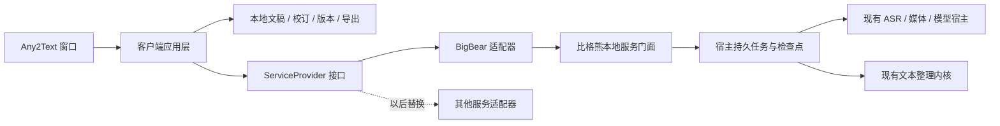

# Any2Text 创作辅助客户端开发计划

2026-11-14 最新发行决定见 §8.11。Any2Text 随比格熊主程序发行，前文的联合离线 ZIP 记录仅供追溯。

当前版本 v0.4，创建于 2026-11-12，更新于 2026-11-13，Asia/Shanghai。**T00～T06 的本地实现与实机验证已完成。** 发版签名和人工内容确认的状态见 §5.1。

Any2Text 随比格熊一起发布，作为音视频转字幕、原文、口播稿与文学剧本的辅助客户端。默认调用比格熊服务，不复制 ASR、模型管理和文本生成内核。客户端通过可替换的服务接口访问能力，已取回成果由客户端独立保存。1～2 小时媒体仍是首版正式验收对象。

配套：[UI 规范](../design/20261112-UI-any2text.md)、[交互原型](../design/any2text-ui.html)、[操作总图](../design/any2text-flow.svg)。计划、图纸与原型统一为 v0.4；图纸为拟议设计，原型为演示，不是运行事实。本文是现行实施权威。

## 1. 用户决定与需求范围

2026-11-12 用户在审核中明确：工具大概率随比格熊一起发布，服务依赖可以接受；两边可配合，避免维护两套 ASR；架构应允许停止使用比格熊、改用其他服务提供方。

此决定替代 v0.2 的“Any2Text 自带独立推理服务、以后由 ai-story 反向消费”方案。独立的是窗口、文稿、校订与导出；识别和整理依赖选定的提供方。不再把独立 ASR crate、模型安装器、推理调度器或后台守护服务作为实施任务或兼容路线。

- **R01 媒体转写**：常见本机音视频生成原文、句级字幕和来源。完成标准是客户端可读取、校对并导出真实结果。对应 T00～T03。
- **R02 两小时体验**：长媒体资源有界、进度可见，取消与失败恢复不丢已提交成果。对应 T00、T02、T03、T06。
- **R03 两类稿件**：口播稿、文学剧本作为独立候选，可编辑、接受、引用回听。对应 T04、T05。
- **R04 联合发布**：复用比格熊同一 ASR/模型/文本内核，明确版本匹配与启动退出行为。对应 T01、T02、T04、T06。
- **R05 可替换提供方**：UI 和文稿不依赖比格熊私有路径、业务 ID；能停止调用并替换适配器，旧成果继续可用。对应 T01、T03、T06。

2026-11-12 用户明确要求保留本地语音识别的多模型选择。T01 门面复用宿主 ASR 模型目录，返回每个配置的 ID、显示名、能力和就绪状态。T03 列出提供方返回的本地模型，按用户选择的配置 ID 提交；未就绪时显示原因，禁止静默换模型。T00 选择某一配置做短样本验证，只代表该次请求。模型选择验收应覆盖至少两个目录项、显式提交与不可用模型反馈；真实转写结论分别记录实际跑过的模型。

首批格式验收：MP4/AAC、MP3、WAV。MOV/MKV/AVI/WebM/M4A/AAC/FLAC/OGG 为兼容目标，按固定服务运行时实测后声明支持；扩展名不是解码保证。无音轨、损坏、纯静音分别处理。

输出：字幕 SRT/VTT、原文 TXT、结构化 JSON；稿件 TXT/Markdown。原始转写只读，校订与候选另存修订。改写稿不能套用原音时间；新配音须重新对齐。音频不能证明的场景、动作、人物身份标为新增/推测；忠实整理与创作改编分开选。

后置：第二个真实提供方、远程上传、OCR、画面理解、翻译、说话人分离、烧录、DOCX、插件市场、全量替换比格熊现有识别入口。不将这些能力作为本轮前提。

## 2. 架构与所有权

配套详细图纸（v0.4，拟议设计，2026-11-12）：[A01 客户端/提供方与数据归属](../design/any2text-architecture.svg)（[预览](../design/any2text-architecture.png)）、[A02 受理/恢复/成果取回](../design/any2text-lifecycle.svg)（[预览](../design/any2text-lifecycle.png)）、[A03 修订与提供方替换](../design/any2text-revisions.svg)（[预览](../design/any2text-revisions.png)）。图中接口与身份以 §3 为准；图纸不能把拟新增服务门面或持久挂接变成已实现事实。



**客户端拥有**：项目与素材引用、取回后的原文副本、校订修订、候选稿、播放定位和导出。自己的本地库只保存文稿与远端任务引用，不执行识别、不重复实现分块调度或模型安装。原媒体默认仍在用户路径，文字独立不等于已经复制视频；文件移动后可重定位，可携带项目另由用户选择复制素材。

**比格熊拥有**：素材授权、媒体探测/解码、ASR、模型管理/GPU 调度、生成任务、检查点、文本模型调用和分章整理。新入口只做薄映射，调用现有内核，不能在 Bridge 路由里复制第二套识别。

**状态边界**：服务端是生成任务状态权威，客户端状态是展示缓存。服务生成成功但结果未取回时显示“结果待取回”；本地原子保存并登记后才显示“已保存到本工具”。客户端的人工修订由自己管理，不要求宿主新增一套文稿 CRUD。

**提供方边界**：ServiceProvider 位于客户端后端；UI 只调用应用层。端口发现、配对、厂商协议、私有字段、上传或本地引用全部封装在 providers/bigbear。领域层不得直接引用 ai-story crate、SQLite、Creator tool ID、模型目录或安装路径。模型选择采用提供方给出的不透明选项，不将厂商 ID 当作本地文稿主键。

首版只做 BigBear 一个生产适配器。用进程外本地测试替身检查替换性，不开发第二个 ASR。发送到比格熊创作是可选交付扩展，缺少该扩展不阻止其他提供方转写或本地导出。

## 3. 最小服务合同

### 3.1 通用操作与比格熊映射

以下是拟议客户端端口，不强迫未来提供方实现比格熊的 URL 或数据库：

- connect / capabilities：身份、协议版本范围、模型就绪、输入方式、时间粒度、暂停/恢复及输入上限。
- prepareInput：登记选定媒体或不可变校订文本快照，返回不透明输入引用。
- submit：提交 transcribe 或 organize；携带 clientRequestId、输入指纹和冻结选项，返回服务任务引用。
- getJob / getJobByRequestId：查询进度、终态、错误、可取回结果；处理提交回执丢失，禁止直接重新生成。
- cancel：仅取消本客户端有权控制的任务。pause/resume 按能力声明，不支持时提示，不伪报成功。
- readResult：分页/分块读取规范化结果，或由适配器流式取回成果文件。
- disconnect：停止当前连接与新提交，不代表任务已取消，不关闭比格熊主程序。

首版比格熊在 `src-tauri/src/local_bridge/any2text.rs` 注册受认证的 `/v1/any2text` 门面，包括 capabilities、inputs、jobs、jobs/by-request、任务查询与控制、结果读取与确认。客户端通过既有 Bridge registry 发现端口并握手确认就绪。旧 `/v1/subtitle/recognize` 继续服务原有调用方，也是 P0 基线入口。

错误归一为：未连接、版本不匹配、模型未就绪、输入失效、能力不支持、受理未知、取消中、执行失败、结果待取回。技术详情留日志，界面提供可执行动作。

### 3.2 输入、结果和身份

首版同机输入只接受用户选定素材或已授权文件引用，宿主仍校验身份、归属和路径/句柄。是否 staging 拷贝由现有授权机制决定，副本计入耗时和磁盘预算，不为避免复制而绕开保护。远程上传后置。

原文合同：schemaVersion、sourceFingerprint、durationMs、timeOrigin、segments[id,startMs,endMs,text]、可选 units、timingQuality、provider provenance。源媒体相对整数毫秒为统一时间基准，音轨起点映射只做一次；缺置信度为 null。无真实单元时间不生成逐字时间。

整理输入冻结校订版本与段 ID；输出包含 text blocks、sourceSegmentIds、完成范围、新增/推测标记。有意缩写和漏段分别表示；机器检查结构、引用、范围及截断，文风与开放语义由代表性人工校对，不强制额外 LLM 评审循环。

客户端 DocumentRevision 使用自有 ID、sourceRevision、parentRevision、接受状态。RemoteTaskRef 保存 providerId、endpointInstance、taskId、attemptId、clientRequestId。稳定客户端身份与短期会话 token 分离，换 token 不应失去自己任务的访问权；owner 由认证绑定，不能信任请求任填字符串。

### 3.3 切换、退出、取消与恢复

切换提供方只影响新任务。已受理任务绑定原提供方与执行身份，不把 A 的 taskId/resumeToken 发给 B。切换前可请求取消旧任务，或让旧任务继续；断开后未确认的取消标“状态未知/待核对”，重连查询原任务，不能自动重新计费。

用户可随时停止客户端调用旧提供方；这不等于远端进程或计费已经停止。已取回文稿可直接打开、编辑、导出。未取回成果需重新连接原提供方取回；不能承诺断开后凭空恢复未落盘内容。

暂停进入 pausing，当前块提交后才显示 paused。确认取消后旧 attempt 保持终态；“继续未完成部分”创建关联的新 attempt，复用经指纹核验的已提交块，旧 worker 迟到结果不能覆盖新 attempt。UI 的用户任务可保持同一条历史，不因换 attempt 重置开发验证预算。

同一提供方/模型/参数才能承诺检查点续跑。更换提供方或模型创建新结果版本，保留旧成果，不承诺跨模型无损续跑或静默混合时间语义。

### 3.4 成果落盘与服务清理

客户端先写项目内临时文件，校验字节数/摘要和最小合同，原子改名，再短事务登记修订；宿主临时路径不能成为客户端文稿唯一存储。文件处理、网络和模型等待均在数据库事务之外。

文件已写但登记失败：核对同一任务/块/摘要后幂等登记，不重新生成。登记存在但文件缺失或损坏：标待取回/损坏，不能显示完整成功。相同规则用于宿主分块检查点。

宿主在客户端确认取回前保留结果，提供保留期限与到期提示；客户端确认仅表示落盘，不等于立即授权删除。双方只清理自己的受管缓存，不删除另一方原媒体或业务库。

## 4. 两小时处理与代码证据

### 4.1 本轮核查基线

`D:/00Dev/bgxiong-ai-story` HEAD `964d4200f0fb15ac41320893725a0625f6d9b49a`，声明 v0.6.1113。只读源码，未运行模型：

- `src-tauri/src/local_bridge/http/routes/subtitle.rs:59` 起：同步等待管线；最终返回全文、SRT 路径、段数和逐文件错误，无分块检查点合同。顶层成功不能替代 results[].error 检查。
- `src-tauri/src/local_bridge/http/server.rs:164` 起：配置 enabled 才启动；`discovery.rs:40` 起定位 LOCALAPPDATA 下 Bridge registry。
- `src-tauri/src/local_bridge/job_store/store.rs:10` 起及 `mod.rs`：Bridge JobStore 为内存 HashMap，不是跨重启恢复依据。
- `src-tauri/src/asr/service.rs:300` 起：整段规范化音频先落盘，然后分块、常驻推理、转换全局时间并聚合。不能写成已实现解码与识别的重叠流水线。
- `src-tauri/src/asr/chunking.rs:9` 起：本地窗口上限 30 秒，另受模型上限限制；首版沿用，不无依据改成 60 秒或增加重叠算法。
- `src-tauri/src/asr/adapters/whisper/mod.rs:1`、`resident.rs:211` 起：已有常驻 whisper-server、令牌和进程管理，不必重复模型宿主。
- `src-tauri/src/text_organize/service.rs`：已有 OrganizeLlmPort、候选存储与分块编排，仍依赖宿主提示词。复用内核，不复制。
- `src-tauri/src/creator_tools/asr_actions.rs:120` 起：授权句柄与 staging 拷贝，复用必要保护，不向客户端暴露完整 Creator 协议。

### 4.2 服务端最小补齐

门面只处理受理、身份和 DTO 映射，执行复用 AsrService、常驻模型、TextOrganizeService。ASR 增加可选分块观察/检查点接口；旧调用方未启用时保持原有行为，长期只有一条识别与分块执行链。

任务元数据复用比格熊持久任务设施；游标与已提交块清单放受管任务成果。T00 必须核实真实写入/恢复符号及注册点，回写文件地图后才挂接。不能把内存 Bridge JobStore 当持久恢复，也不在客户端建另一套执行库。既有设施不足时只提出最小任务类型扩展，不迁移所有旧任务。

每块先原子提交文件，再短事务登记。用 task/attempt/chunk 指纹防止重复登记与迟到结果覆盖。进度按已提交源时间并集算，不重复计算重叠；尾块必须处理，静音不压缩源时间。结果时间校验须区分真实重叠发言和非法倒序。

### 4.3 性能必要性与优化触发

首版优先保留“整段 PCM 落盘，再按现有块推理”，不以重写全流水线作为前置。16 kHz 单声道 16 bit PCM 是 32,000 字节/秒，两小时约 230.4 MB。此为磁盘缓存量，不包含原视频、模型、staging 副本和波形，不要求全量驻内存。恢复期间保留必要规范化缓存，避免每次重新解码两小时。

必须使用流式文件读写与有界缓冲，模型常驻占用单列。已有实现是否满足本机预算需实测；首块延迟或缓存实测超目标后，再在比格熊同一媒体内核优化，不另建客户端解码管线。现有分块若出现漏尾/跨块错位，按具体样本定向修正，不能平均分字伪造时间。

比格熊统一调度 GPU，识别初始并发 1；与其他创作任务竞争时排队，不能抢停他人进程。客户端结果分页、虚拟列表、索引搜索、分级波形；无法播放编码可由服务生成预览代理，识别不等待代理。

长文本沿上下文预算分章，提纲/人物/术语摘要只作上下文，不替代原文。每块候选留存，失败只重做对应块，字幕始终可导出。服务自行管理模型密钥与费用；审核不授权付费调用。

取消目标为 5 秒内停止该任务的重型工作并确认。共享进程先核对归属，不能杀主程序完成取消；后端无安全单任务取消时，明确其独占调度及终止范围并实测。无法确认停止则标未知，不启动冲突的新推理。

## 5. 阶段、双仓协作与文件地图

下列任务按依赖实施，当前结果见 §5.1。用户于 2026-11-12 要求 T00～T06 全量推进，验收记录随进度补齐。每项仍按实际构建、运行和安装证据记账。

顺序：P0 核实基础 → P1 宿主转写服务补齐并冻结 → P2 客户端接入 → P3 先整理服务验收冻结、再接客户端 → P4 联合交付。两边可以配合，但一轮验收中不能边改基础服务边沿用旧消费者通过结论。

现有文件标“现有”，其余为拟新增。Any2Text 已在比格熊主仓同级克隆，基线为 `main` 的 `b30c2de`。T00 的正式构建、任务和打包入口见下方接手记录。

### P0 / T00 接口与运行前提，1～2 个工作日

实物：真实请求脚本、短样本原文/SRT、运行身份和十分钟吞吐记录。拟新增本仓 `scripts/probe-bigbear.ps1`，测量写回本计划，不另建证明系统。宿主及模型环境冻结。

读取现有 local_bridge/discovery.rs、http/server.rs、routes/subtitle.rs、ASR 与持久任务入口，核实安装 EXE、启用状态、认证、模型与输出。旧 REST 只用唯一文件名的授权样本，默认落点是系统 temp 的 bgxiong_video_subtitle，按真实返回路径取回，不假称可指定输出目录；不覆盖既有同名成果。

先短输入确认请求/回执/退出码，再测十分钟。条件满足可做一次两小时旧服务参考测量；旧接口不提供分块检查点不是 P0 失败，也不是新恢复能力通过。完整两小时恢复验收属于 P1，首版长媒体要求没有延至发布后。

服务未启用、缺模型/样本/权限时记录准确缺口，不自动装多模型、改用户原库或付费。P0 结束须明确持久任务写入/恢复的真实符号、文件和启动注册点；未满足即阻止依赖它的 P1。

#### 2026-11-12 T00 执行记录

- 本机 Bridge `GET /v1/health` 返回成功。实例 `ai-story-ea6edfa4`，地址 `127.0.0.1:6473`，具备 `subtitleRest` 和 `asrSelectionV1`，媒体运行时报告就绪。监听进程来自 `D:/00Dev/bgxiong-ai-story/src-tauri/target/debug/bgxiong-ai-story-tauri.exe`，Windows 文件产品版本 0.6.0。证据属于当前开发实例。
- 新增 [probe-bigbear.ps1](../../scripts/probe-bigbear.ps1)。用宿主仓现有 `docs/dev/reports/asr-e2e-20261017/ref8s.wav`（实测 8.000 秒，PCM 24 kHz）提交一次 `POST /v1/subtitle/recognize`，指定本地 Whisper medium 配置、中文 `zh`、段级时间和 SRT。本机 `artifacts/t00/any2text-t00-1bb868db4e994621aa2cb15d47b688d3/` 保留请求、健康回执和原始响应。
- 响应业务码 `2001`，`data:null`。宿主日志在同一请求后约 26 毫秒记录运行时拒绝加载。实际目录 `data/runtimes/whisper/20260625` 的五个必需项中缺 `native-intake.json`，Whisper medium 权重存在。该实例的本地配置文件中只查到一个已登记的语音识别配置，未找到可直接用于本次请求的第二个配置。问题归类为运行环境缺件，尚无证据表明是探针请求错误或功能回归。
- 停止于短样本转写。原文、SRT、成功落盘分支、十分钟吞吐、两小时恢复及后续阶段均未通过运行验收。冻结基线内无可用替代配置，保留现场。待宿主有完整的 Whisper 运行包或另一套已就绪的本地语音识别配置后，用同一探针和样本恢复验证。

在两仓位于同一父目录的机器上，先从本机模型目录查得配置 ID，再运行：

```powershell
& .\scripts\probe-bigbear.ps1 -MediaPath '..\bgxiong-ai-story\docs\dev\reports\asr-e2e-20261017\ref8s.wav' -ModelConfigId '<本机就绪模型的配置 ID>' -TimeoutSeconds 120
```

续办核对：通过原实例的 Creator MCP `asr.models.list` 读取实时目录，返回本地 Whisper medium 一项。权重已安装，`runtimeReady=false`、`inferenceReady=false`，原因为 `missingEnvironment`。用户随后开始安装 Whisper 运行时，下载进度达到 171,180,032 / 469,512,483 字节时原实例退出。Bridge 转到修图隔离实例 `ai-story-39c5e1ac`，其数据与原安装目标分开。等待原实例恢复安装，核对同一实例的目录和就绪状态后再提交 8 秒样本。

#### 2026-11-12 22:02 +08:00 资源机接手与短样本验收

- `RELEASE-HEAVY-01 / DESKTOP-4OVG8RB`。主仓 Git 根为 `L:\00Dev\bgxiong-ai-story`，从主仓 `origin/main` 的 `32d775dfc0` 读取双机交接清单中的「Any2Text 公开仓与 T00 接手」。同级 `L:\00Dev\bgxiong-any2text` 的 `main` 经 `git pull --ff-only` 核对为 `b30c2ded9eaef37a03b8ae0296f7578cbdfefa73`。
- Bridge 实例 `ai-story-887d6fe9` 在 `http://127.0.0.1:5977/v1/` 返回健康，具备 `subtitleRest`、`asrSelectionV1`，媒体运行时就绪。Creator MCP `127.0.0.1:19469` 与 Bridge 属于同一 PID `35284`。运行的是隔离开发 EXE `L:\00Dev\bgxiong-ai-story\logs\subtitle-format-live\delivery-target\debug\bgxiong-ai-story-tauri.exe`，Windows 产品版本 `0.6.0`，SHA-256 `5d4de63a93e1a8297d72a293eb6da7d2a53fcd048aa188b1a0a92eacbd63aebd`。
- Creator MCP `asr.models.list` 的原始回执为 `L:\00Dev\bgxiong-any2text\artifacts\t00\asr-models-list-1b278240aec444fe9f1dba0451d4c163.json`。目录返回四个本地配置。Whisper-tiny 与 Whisper-large-v3 均已安装、`runtimeReady=true`，支持 `zh` 和段级时间戳。提交前 `inferenceReady=false`，宿主在处理请求时按显式配置加载。Qwen3 当时 `runtimeReady=false`，FireRed 缺模块。两次请求均由探针显式传入本机配置 ID。
- 首次以 Whisper-tiny（`45a9a339-8af4-4e97-a6db-e952cba92ca7`）提交原 8.000 秒 `ref8s.wav`，服务耗时 7,738 ms。顶层 `code=0`，但逐文件回执有错误，探针退出码为 1。宿主诊断 `ASR_TIMED_TEXT_INVALID` 的结构错误中，最后一段和最后一个时间单元结束于 8,320 ms，超出样本时长。原始 `response.json` 与 `host-asr-diagnostic.json` 均保留在 `L:\00Dev\bgxiong-any2text\artifacts\t00\any2text-t00-71fa81fb69e547f4b65c450d95d1ba6a\`，这次未生成验收文件。
- 用同一探针和样本，显式改选 Whisper-large-v3（`e9ffec83-6609-47b1-a168-01c39166647b`），请求 `zh`、`segmentTimed`、`srtOnly`。宿主日志显示该旧字幕入口内部按 `unitTimed` 执行，再编排 SRT。探针退出码 0，客户端请求耗时 **11,322 ms**，服务耗时 **11,301 ms**。请求、健康回执及 `response.json` 随成果保存在同一次运行目录。
  - 原文 `L:\00Dev\bgxiong-any2text\artifacts\t00\any2text-t00-f1fe1ff43b244dacbfa9ca6193db47b9\transcript.txt`。读回 74 字节、三行中文，非空且与回执的 `fullText` 一致。
  - 字幕 `L:\00Dev\bgxiong-any2text\artifacts\t00\any2text-t00-f1fe1ff43b244dacbfa9ca6193db47b9\subtitles.srt`。读回 208 字节，FFprobe 识别为 SubRip。四条序号连续、文本非空，时间正向且互不重叠，覆盖区间在 00:00:00,300 至 00:00:08,000 之间，未超出素材时长。
- **隔离开发版 8 秒真实转写与落盘验收通过。** 十分钟吞吐、安装版和两小时恢复在这一轮未运行。
- 主仓源码核对：日常开发运行入口为 `scripts/dev-launch-current.ps1`，0.6.1113 正式打包入口为 `scripts/build-installer-full.ps1`。任务写入由 `ai_task_scheduler.rs` 的 `AiTaskScheduler::submit` 调用 `infrastructure/persistence/sqlite/ai_task_ops_sqlite.rs` 的 `insert_queued` / `insert_running`。`main.rs` 初始化调度器并注册 checkpoint sink，启动 `async_media_resume::boot::resume_all_interrupted_async_media_jobs`。旧字幕 Bridge 的 `JobStore` 仍在内存。P1 需为 Any2Text 增加对应的任务类型与恢复分派，旧字幕入口无可直接沿用的转写检查点。

#### 2026-11-12 22:25–22:27 +08:00 安装版复验

- 已切换为本机安装目录运行的 `K:\bgxiong-ai-story\bgxiong-ai-story.exe`，Windows 文件产品版本 `0.6.0`，SHA-256 `f34f147a6de1536d7aa82ac36403d1bdc7c71bf4edefdc95077fbf80bb2dbba7`。Bridge `ai-story-b50f04b8` 在 `http://127.0.0.1:9606/v1/` 健康，和 `127.0.0.1:18451` 的 Creator MCP 同属 PID `28800`。重新调用 `asr.models.list`，回执保存在 `L:\00Dev\bgxiong-any2text\artifacts\t00\asr-models-list-4e5b2e9909ee42df9dbb13bff6b794cf.json`。两套 Whisper 配置均已安装、运行时就绪，支持中文和段级时间戳，提交前均未预加载。
- 同一探针和 8.000 秒样本，显式指定 Whisper-tiny（`45a9a339-8af4-4e97-a6db-e952cba92ca7`）复现同一结构错误。最后一段及最后一个时间单元仍结束于 8,320 ms。服务耗时 5,338 ms，探针退出码 1。`response.json` 和 `host-asr-diagnostic.json` 保存在 `L:\00Dev\bgxiong-any2text\artifacts\t00\any2text-t00-7b3ca5a75ac74daab999cf8bc52c5cc6\`。
- 同一安装版实例显式指定 Whisper-large-v3（`e9ffec83-6609-47b1-a168-01c39166647b`）对照通过，探针退出码 0，请求耗时 **9,179 ms**，服务耗时 **9,158 ms**。原文 `L:\00Dev\bgxiong-any2text\artifacts\t00\any2text-t00-c12572656d434fa785d0afb092febe4a\transcript.txt` 读回 74 字节，非空并与回执 `fullText` 一致。字幕 `L:\00Dev\bgxiong-any2text\artifacts\t00\any2text-t00-c12572656d434fa785d0afb092febe4a\subtitles.srt` 读回 208 字节，FFprobe 识别为 SubRip，4 条均有文本且时间有序、互不重叠，末条结束于 8,000 ms。
- **安装版 8 秒转写和落盘验收通过（Whisper-large-v3），Whisper-tiny 的时间越界已跨实例复现。** 十分钟吞吐和两小时恢复待验。

#### 2026-11-12 十分钟吞吐基线

- 资源机 Intel Core i9-10980XE、约 125.2 GiB RAM、RTX 4090 24 GiB、驱动 621.14。使用同一安装版 Bridge `ai-story-b50f04b8`，从实时 Creator MCP 目录显式选择 Whisper-large-v3 `e9ffec83-6609-47b1-a168-01c39166647b`，`zh`、`segmentTimed`、`srtOnly`。原 `ref8s.wav` 加 2 秒尾静音后循环 60 次，得到 600.000 秒、19,200,078 字节的 PCM 16 kHz 单声道 16 bit WAV。模型推理精度取宿主配置，探针无精度覆盖。
- 原文和 320 条 SRT 字幕已落盘，最后一条结束于 598.000 秒。请求 27,388 ms，服务 27,372 ms，端到端服务耗时 / 源时长约 0.0456。2 秒采样记录宿主峰值工作集 246,206,464 字节、Whisper 进程峰值工作集 499,748,864 字节、峰值私有内存 5,163,036,672 字节。显卡整卡占用 4,564～8,449 MiB，系统临时盘空闲量采样差约 33.8 MB。整卡和整盘采样包含同机活动。
- 原始请求、回执、目录、媒体信息、结果及采样保存在 `L:\00Dev\bgxiong-any2text\artifacts\t00\throughput-9747684f8c6f43ae826cc23d96773ba2\`。重复样本用于吞吐与边界复现，真实长节目的听辨质量待验。
- 首次两小时恢复验收预算冻结为墙钟 20 分钟、宿主和模型新增私有内存合计 8 GiB、整卡占用较基线增加 8 GiB、测试 WAV 的宿主管理盘新增 1 GiB、首次提交块 60 秒。预算应用于本机合成基线复验，视频输入的原始 staging 副本另按实际文件大小记账。

### P1 / T01～T02 比格熊转写服务，3～5 个工作日

T01 合同与门面落在本仓 `contracts/v1/service-provider.schema.json`、主仓 `contracts/any2text/v1/service-provider.schema.json` 和 `src-tauri/src/local_bridge/any2text.rs`，由现有 `http/server.rs`、`app_state.rs`、`discovery.rs` 装配。两仓校验固定合同版本和摘要，能力、输入、任务、结果均通过公共 DTO。

T02 检查点由宿主 `src-tauri/src/asr/execution_checkpoint.rs` 持久化，现有 `asr/service.rs` 负责提交、核验与恢复。进度写入现有 `ai_tasks` 的任务载荷，`async_media_resume/mod.rs` 保护可恢复记录，Bridge 挂载后恢复待处理任务。沿用 chunking、resident、媒体内核和既有模型协议。

闭包：路由声明 → Router → 版本/能力公告 → 身份与授权 → 持久任务 → worker → 结果读取/确认。真实装配入口验收；内部函数通过不能证明路由可用。结果必须有可取回的结构化字幕，不能仅有宿主临时路径。

验收：真实短链路、完整 120 分钟、块边界/尾块、暂停/取消/重启、丢失提交回执后查询、块文件写入但登记前中断；不取消其他创作任务。定向回归旧字幕入口及直接复用调用方。冻结服务、合同、模型后交 P2。

### P2 / T03 客户端可用转写，3～5 个工作日

本仓 `src-tauri/src/{provider,application,workspace,export,lib}.rs` 定义端口、用例、文稿存储、导出和 IPC 装配。`providers/bigbear.rs` 封装比格熊协议，`ui/src/main.tsx`、`ui/src/api/any2text.ts` 实现五页工作区及其调用。客户端采用 Tauri、React、Rust 和 SQLite。

后端适配、取回、短事务保存、离线导出；前端不自行拼宿主协议。校订保存使用 expectedRevision，轮询不打断焦点/输入法。独立窗口可调用冻结服务，回听、校订、导出；比格熊断开后已落盘文稿继续工作。此阶段不改服务或模型，缺口停止并明确最小服务修正。

验收：真实 UI→适配器→宿主→本地保存→导出；重复取回不重复导入；服务断开仍能编辑导出；长列表搜索定位、保存失败保留编辑。桌面目标 1024×768 和 1440×900，原型窄屏通过不代替安装版验收。

### P3 / T04～T05 口播与文学剧本，3～5 个工作日

T04 门面的整理入口在主仓 `src-tauri/src/local_bridge/any2text_organize.rs`，在该处冻结来源、管理分章文件与覆盖校验，调用现有 `src-tauri/src/text_organize/service.rs` 的模型、分章、提示词和计费入口。

T05 本仓的 `providers/bigbear.rs` 映射 organize，`ui/src/main.tsx` 提供整理页面，`workspace.rs` 保存来源与候选。稿件落盘后可接受，编辑后需重新接受，来源更新后旧候选进入待核对状态。

实物：两个可导出稿件类型、来源回听、接受/编辑和失败章节恢复。复用 P1/P2 有效原文，不重复识别两小时音频。结构不合法/截断与有意缩写分开，不能用文风门禁拒收可用稿件。

### P4 / T06 联合发行与替换边界，1～2 个工作日

实物：随比格熊发布的辅助入口及明确版本握手。优先同一交付目录提供两个窗口入口，只分发一份模型/运行资源；打包沿 T00 确认的主项目正式入口，不能虚构脚本已存在。

先用一个进程外本地测试替身走同一 ServiceProvider 端口，验证不依赖 BigBear 私有字段；不开发第二个真实 ASR。该检查不证明其他模型质量或性能。

验收：兼容版本可连接，不兼容时禁止新提交但旧文稿可用；服务未启动时按用户动作启动已安装比格熊；关闭辅助窗口不误杀主程序；比格熊退出显示断开/恢复；其他任务不受影响；切换提供方不错误转发旧任务；停用/卸载比格熊后已取回文本仍可编辑导出。

发送到比格熊创作是可选交付扩展，未接通时本地导出仍完整。接入前核实既有 `ui/src/features/text-workbench-input/TextWorkbenchInputActions.tsx` 与 `WorkbenchOperationPort`，用户选定对象后按宿主入口导入候选，不直接写库，不采用旧场次/故事板主线。

### 5.1 2026-11-13 双仓实施与验证记录

- T01 门面已在隔离开发宿主实际启动。`/v1/any2text` 使用 Bridge 本机配对凭据和独立短期会话，服务实例身份与持久服务身份分离。请求去重、按请求 ID 查询、会话续期及跨客户端拒绝访问实测通过。首轮 MP4/AAC 发现解码比容器多 21 ms，原始证据见 `artifacts/live-acceptance/short-09684a8318134099a0099b6501ef9442/`。新版按源时长限制归一化音频，WAV、MP3、MP4/AAC 均通过时间轴和摘要校验，原始证据见 `artifacts/live-acceptance/bridge-final-b6528ce774024fda987829ebde7402c0/results.json`。
- T01 完整格式复验在实例 `ai-story-fc547860` 通过。损坏文件、无音轨、不可用模型和纯数字静音按不同结果返回。双音轨 MP4 按请求选择第二轨。测试回执见 `artifacts/live-acceptance/formats-final-bd736e26c9af4b3a929c392f36934c10/results.json`。数字静音按 PCM 样本判定，低音量的非零样本仍交给用户选中的模型。
- T01/T02 最终字幕宿主 `ai-story-8dd838dd` 再次通过首批格式、选轨、模型拒绝、跨客户端取消拒绝及提交回执丢失后的按请求 ID 找回。旧字幕入口同一实例实际落盘原文与四条字幕，末条止于 8.000 秒。证据在 `artifacts/live-acceptance/final-regression-80370dcfe3e740a18ffb8a57de11dc2d/`。
- T01 兼容目标用实例 `ai-story-12c88021` 和同一显式模型实测。MOV/H.264/AAC、MKV/H.264/AAC、AVI/MPEG-4/MP3、WebM/VP8/Opus、M4A/AAC、AAC/ADTS、FLAC、OGG/Vorbis 的样本均成功取回有效字幕，证据见 `artifacts/live-acceptance/compatibility-03b1164eb508446082a8ec7aa568961a/results.json`。
- T02 两小时样本由 `ref8s.wav` 加尾静音后循环构造，PCM 时长 7,200.000 秒。新版用本机 Whisper-large-v3 通过暂停、取消、更换 attempt 续跑、强制冷重启和进度登记断点。测试在隔离库将已提交游标回退到 0，保留分块文件。Bridge 从 `ai-story-0c4261ca` 重启到 `ai-story-6ec70d1c`，持久服务 ID 和 attempt 均一致，复用了 4 个旧分块且文件修改时间一致。最终 2,221 段，末段结束于 7,198.008 秒。首块 22.265 秒，取消确认 0.156 秒。352.1 秒采样中，宿主进程树峰值私有内存 5,447,102,464 字节，整卡 VRAM 2,289～6,214 MiB，宿主管理目录新增 461,347,919 字节，各项均在冻结预算内。证据见 `artifacts/live-acceptance/long-cold-restart-27af036966a54ab1acbad810f81d85d8/`。
- T02 自然中文实录取自 [LibriVox《朝花夕拾》](https://librivox.org/chao-hua-si-she-by-lu-xun/)，将 Jing Li 的朗读从起点裁为 7,200 秒。安装版首轮提交了前 36 个分块，第 37 块的最后字幕结束于该块内 59.820 秒，超过 30 秒的源范围，原始回包已保存在 `artifacts/live-acceptance/host-data/logs/bgxiong-ai-story-asr-result-8174b500-5e5e-4890-881b-94eb05a4d075.json`。同一模型在该段按两个 15 秒区间独立解码均通过时间轴校验，见 `artifacts/live-acceptance/natural-mandarin/timestamp-witness/results.json`。宿主按源采样帧缩小失败区间，使用相同冻结模型与选项有限重试。
- T02 同一任务从 18 分钟续跑至 67 分钟，已提交 134 个分块。第 135 块的末字幕在源尾多出 7 ms，按两个更短区间复现 4 ms 和 2 ms 的末尾偏差。原始回包 `artifacts/live-acceptance/host-data/logs/bgxiong-ai-story-asr-result-a40eda1f-eb3a-4962-8216-b71c058c7c13.json`。宿主按 Whisper 的原生 20 ms 时间步长，只将一格内且起点在有效源区间的终点收敛到最后一个样本。较大的越界仍走同模型重试和错误路径。定向测试 4 项通过，见 `artifacts/whisper-timing-tests.log`。
- T02/T03 最终在 `ai-story-8dd838dd` 从 67 分钟恢复，沿用 Whisper-large-v3 `e9ffec83-6609-47b1-a168-01c39166647b`。前 134 块的摘要和修改时间一致，最后一次恢复的 ASR 执行耗时 170.658 秒。桌面实际取回并导出原文 81,028 字节、SRT 154,082 字节。独立读回确认 2,060 条字幕均有文字、编号连续、时间有序无重叠，最后一条止于 01:59:59.967。原文、SRT、修订导出与复用清单在 `artifacts/live-acceptance/desktop-natural-clock-49b12c825d8649fea8d1a54991032a65/`。开头、跨块、中段、末段四处用维基文库对应章节做汉字抽样对齐，相似度 90.3～94.7%。片段和各自文本来源见 `artifacts/live-acceptance/natural-mandarin/review-windows/results.json`，该数值只描述四处文本抽样。
- T03 安装版 Any2Text 通过真实 Bridge 导入、显式选型、提交、取回、音频回听、波形、搜索和校订。重复取回保持文稿修订历史，模拟并发保存冲突后界面仍保留未保存内容。已读回离线 SRT、VTT、TXT 和 JSON，四种宽度的五页检查通过。在线验证记录在 `artifacts/live-acceptance/desktop-matching-380d644c4dd74791b9d040c1f4c54987/results.json`。离线复开与候选编辑撤销接受的记录在 `artifacts/live-acceptance/offline-a8d13f8eab8241ff89fbd0cb133b96e1/results.json`。
- T03 实际桌面从实时目录展示多个配置。选择不可用配置时显示原因并阻止开始转写，显式切换至就绪配置后恢复提交，见 `artifacts/live-acceptance/model-selection-7925d12bb355402aa8288e01ea5afb58/results.json`。
- T04/T05 已接入比格熊本地文本模型、带来源的冻结校订和分章检查点。安装版通过本地 Qwen3-4B 生成、取回、接受并导出忠实口播稿和创作文学剧本，两份稿件均有 TXT 和 Markdown，见 `artifacts/live-acceptance/desktop-matching-380d644c4dd74791b9d040c1f4c54987/`。文学剧本首轮纯创作段落使用空来源，宿主现以 `【新增/推测】` 标注并持续校验输入段落覆盖。既有同步字幕路由在同一宿主回归通过，见 `artifacts/live-acceptance/legacy-subtitle/any2text-t00-8bf397c022594142b83244dec5c69e6f/`。
- T04 分章恢复用隔离宿主 `ai-story-58f426d8` 和本机 Qwen3.8-27B Q4 配置 `01f8f638-6162-474f-b050-86829e82de02`。已提交首章（45 秒、12 个输入段中的 5 个）后暂停，注入第二章回执未知状态。恢复原 attempt 返回 `vendorFailed`，显式续跑创建新 attempt，取回全部三章并核对 12 个输入段全部覆盖。首章摘要和修改时间一致。完整执行日志、摘要与结果见 `artifacts/live-acceptance/organize-sections-73c47da75e1f46d3b795508ae7c853a3/`。
- T05 独立客户端离线编辑已接受稿件后重新接受，校订来源更新后旧候选显示「来源待核对」，导出原候选被拒绝。证据见 `artifacts/live-acceptance/offline-source-change-29b5fab5d275422aa419ce6145165db7/results.json`。
- T04/T05 最终读回发现创作模型会给新增角色和场景附上原文 ID。宿主保留关联来源，并将含有无法与所引原文逐字匹配内容的创作段落标为「新增/推测」。校验比较文字和数字，供编辑复核。实例 `ai-story-12c88021` 重新生成、接受和导出两类稿件。文学剧本的三个新增段落均保留标记，成品与验证记录见 `artifacts/live-acceptance/desktop-draft-origin-eccde16374fd4b2790e7f664e2ef0440/`。
- T06 正式入口的输入预检在主仓更新至 `8a6fee6af3` 后通过 28 项，详见 `L:\00Dev\bgxiong-ai-story\logs\release-inputs-20261113-012346-50992\result.json`。联合 NSIS 验证包成功安装两个程序并建立本包专属 Any2Text 快捷方式，生产数据指针摘要一致，见 `artifacts/live-acceptance/joint-final-install.json`。安装版从客户端按按钮拉起同目录宿主。关闭辅助窗口后宿主仍可用，宿主退出显示断开并在同一服务重启后恢复，见 `artifacts/live-acceptance/joint-lifecycle-5177d0be96ae4d97a0e938cafb5b772e/results.json`。真实桌面连接旧 Bridge 时阻止提交。进程外替身验证旧任务不会转发且离线文稿可继续读写。
- T06 隔离联合包更新安装与卸载均退出 0。卸载移除两款程序和专属快捷方式，生产数据指针摘要一致。随后用独立 Any2Text 从离线工作区重新读回原文、校订及已接受稿件并完成导出。卸载和离线证据见 `artifacts/live-acceptance/joint-final-lifecycle-5fe8db298bc2470585e2bd0c5d0637ff/`。
- T06 含最终字幕实现的隔离验证包 0.6.1118 完成更新安装、启动、断线恢复、卸载、卸载后离线重开与来源变更待核对。安装及内容摘要 `artifacts/live-acceptance/joint-terminal-clock-install.json`，生命周期和卸载 `artifacts/live-acceptance/joint-terminal-clock-lifecycle-5d73b54022814662b40fecd0e9d93977/`。
- T06 最终联合验证包 `L:\00Dev\bgxiong-ai-story\src-tauri\target-any2text-nsis-validation\debug\bundle\nsis\bgxiong-any2text-joint-validation_0.6.1119_x64-setup.exe` 的 SHA-256 为 `77ec83ba7b4337341f2910b630e4d616ee4d34fe90d158135dc1fe04d2d57b36`。安装摘要见 `artifacts/live-acceptance/joint-draft-origin-install.json`。两个程序均落盘，客户端能启动宿主并握手，关闭客户端后宿主继续运行，宿主退出与重启分别显示断开与恢复。卸载退出 0，两个程序和专属快捷方式已移除，独立客户端从原工作区离线重开、编辑并导出通过。证据见 `artifacts/live-acceptance/joint-draft-origin-lifecycle-5237289ab2644aef8d9ea45ac8079fc4/`。
- 两仓合同摘要一致，PowerShell 与 Python 验证脚本解析通过。客户端的进程外提供方替换测试和宿主分块定向测试（8 项）通过。主仓既有 ASR 隔离套件受其锁文件漂移及引用的 `asr/adapters/whisper/execution.rs` 缺失影响，分块定向验证直接编译当前生产分块模块。
- 本轮交付本地未签名联合验证包。正式发行签名和发布记为 `NOT_RUN`。人工听辨和剧本改编意图确认同为 `NOT_RUN`，四处朗读样本、对应来源和成品稿件已备齐。

## 6. 验收档位、预算与生效

**决定来源：模型依据现有需求与用户约束决定。** 本轮 BGX333 为标准深度文档/源码审核和文档一致性检查。后续对已选链路采用分阶段全面验收：真实输入、持久恢复、宿主定向回归和联合安装；不扩全仓整改、全模型矩阵或无限搜索。

每阶段最多两轮定向修正；同一输入/依赖的有效结果不重复运行。首次实现、脚本错误、环境缺失、真实回归分别定责。改名、换 attempt、换执行者不重置开发预算。

P0 十分钟基线记录设备/驱动、服务/模型、精度、文件和参数。首次两小时长跑前冻结 runTimeout、RAM/VRAM/磁盘上限及可接受首块延迟；不得失败后抬上限求绿。墙钟预算参考实测吞吐及加载/解码开销，仅是运行停止条件，不冒充商业速度承诺。无法确定合理资源预算时先停长跑，短接口检查可以继续。

记录加载、素材拷贝、解码、识别、合并、取回、整理和总耗时；各进程峰值 RAM、GPU VRAM、临时磁盘、首块时间、取消延迟和恢复重做量。观察 10/60/120 分钟工作集，缓冲不得随时长无界增长，模型常驻占用单列。

RTF=识别耗时/媒体时长。0.25 对应两小时约 30 分钟识别，1 对应约 120 分钟，只是换算，未实测不承诺固定倍速。可控样本检查源偏移、块边界和尾块；真实开中尾/跨块样本人工核查听辨质量，报告 CER/WER 时注明授权标注与归一化口径。

智能体执行与改动匹配的 payload、任务/恢复、结果落盘和定向回归，并遵守主项目适用必跑项。人工确认中文听辨、剧本改编意图和联合安装体验。未执行的 CI/人工项标 NOT_RUN，不用 mock、API 旁路或原型替代用户入口。

故障注入在隔离样本与数据副本，不用用户原库。schema 变更沿主项目独立迁移工具。服务变化要构建重启，安装内容变化需升交付版本并重装；本轮仅文档变化不需要重启产品。

## 7. BGX333 审核记录与结论

v0.3 审核使用 BGX 5.1.0（§7.1～7.2）；v0.4 使用本机已安装 BGX 6.0.0 补做图纸与 UI 复核（§7.3）。两轮均未改业务代码、未修改 ai-story、未构建、未运行模型、未提交 Git。

### 7.1 发现与修订

- **H01 / 架构取舍已纠正**：v0.2 §3/P1 的独立 ASR 服务前置与用户最新“随比格熊发布、允许依赖、避免两套 ASR”决定不符。删除原路线，改为单宿主内核、客户端适配器和本地文稿；不保留被否决方案为可选兼容。
- **H02 / P1 计划缺口已修订**：原 P0 要求旧同步接口提供分块成果，但 routes/subtitle.rs:59–85 只返回最终结果。现 P0 验既有能力，T02 承担新检查点合同；不将已知不支持的接口作为永久阻塞前置。
- **H03 / P1 计划缺口已修订**：job_store/store.rs:10–44 是内存状态，asr/service.rs:300–385 不能证明跨重启检查点。T02 补持久挂接、块提交、attempt 和迟到结果规则；真实持久入口由 T00 查明后才能实施，不猜符号。
- **H04 / P1 计划缺口已修订**：旧计划未保证结果脱离服务。§2/§3 明确客户端所有权、结果取回落盘、媒体重定位、清理与更换提供方的在途任务处理。已经下载的文字独立可用，未下载结果不做虚假承诺。
- **H05 / P2 可简化项已收敛**：原多个独立 crate、ASR 提取和新模型环境没有当前需求必要性。bgx-asr-core/Cargo.toml:11 与 build.rs:1–9 还依赖生成器/schema。新方案不抽取，客户端普通模块即可，后端能力留宿主。
- **H06 / P1 可实施性缺口已修订**：原计划只列功能，注册/权限/任务/结果闭包与修订归属不清。T01～T06 补文件地图、调用方与验收；校订/导出归客户端，生成归宿主；先服务冻结、后客户端接入。
- **H07 / P2 性能过度设计已收敛**：现有常驻模型、30 秒分块与整段 PCM 落盘已存在。先实测；仅当首块延迟、内存或磁盘证据显示不足，才提出同一内核最小优化，不降低恢复/质量要求。

以上优先级描述设计缺口的影响，不是宣称已发生运行故障。已正确并保留：原文/稿件分离、源时间保护、常驻模型、素材授权、短事务方向、校订冲突提示。

### 7.2 覆盖、未验与下一步

纳入 B01 素材→识别→本地成果；B02 暂停/取消/崩溃→恢复；B03 原文→候选→接受→导出；B04 连接/退出/替换→旧文稿使用。证据为源码与文档，运行层 NOT_RUN。

排除模型协议升级、完整 Creator 重构、全部任务迁移、重写 ASR、第二个真实提供方；没有当前必要性。只维护同一 PLAN 与 UI 规范/入口，不另建重复台账。

需求已有任务对应，架构决定已按用户最新指令明确，关键风险有处理与可执行阶段。**计划审核通过，待实施**，不等于产品、安装或两小时性能已验收。

下一步为 T00。实际服务/模型就绪、授权样本、持久任务真实符号、定量资源预算是 T00 的前置产物，未完成就停止依赖阶段；不据本次审核自动下载安装、付费或改原库。明确要求实施后才写业务代码。

### 7.3 BGX 6.0.0 图纸与 UI 复核 / v0.4

本轮按用户“补齐架构图，界面整洁、紧凑、合理利用空间”的要求执行标准深度审核。沿用 v0.3 最新决定：复用比格熊服务，保留可替换提供方；不恢复独立 ASR 路线。已保留上轮 H01～H07 的修订及 T00～T06 阶段边界。

- **H08 / P2 图纸缺口已补齐**：原资料只有简要结构 Mermaid 与 UI 总图，缺少可查的进程/数据归属、受理恢复取回与修订关系详图。新增 A01～A03 的 SVG 图源与 PNG 预览；明确已有内核、拟新增门面及 T00 待核实的持久入口。源代码证据仍见 §4，不把计划图当作源码事实。
- **H09 / P2 布局已完善**：原型的大标题、说明块及分散辅助区占用工作空间。五页改为紧凑导航、简短页名与就近操作；校对采用左侧定位/字幕、右侧编辑，原文按需展开，移除重复说明与无实际作用的控件。默认保留一处演示说明；1024×768 可见保存动作，窄窗自然换行，不压缩字号硬塞。
- **H10 / P1 原型版本语义已修订**：未保存校订不能直接用于生成、接受或校订导出；原文导出与校订分开，原文不被覆盖；接受稿再编辑立即撤销接受，来源修订变化阻断旧稿直接导出。更改仅限演示原型，正式 expectedRevision、落盘和冲突处理仍由 T03/T05 实施。
- **H11 / P1 原型与新架构已对齐**：补提供方连接/断开、取消待核对、生成完成待取回、取回保存与离线文稿状态。服务进度标为“服务已提交片段”，不冒充客户端保存；取消须等待确认，已生成成果不再显示取消运行任务。原型仅模拟一个比格熊提供方，第二适配器、真实任务恢复与跨进程数据持久化未实现。

图纸到任务的对应：A01 → R04/R05、T01/T03/T06、§2～3；A02 → R01/R02/R05、T00/T02/T03/T06、§3.1/3.3/3.4；A03 → R03/R05、T03/T04/T05/T06、§3.2～3.4。U01 导入/U02 队列/U03 校对/U05 导出 → T03；U04 整理 → T05；共用连接面板 → T03/T06。验收细节见同版 [UI 规范](../design/20261112-UI-any2text.md)。

验证范围由模型按本次设计修改确定：静态文档/链接/图源核对、浏览器原型关键路径、五页四档宽度与浅深色预览；不做业务构建、模型运行或扩大到主项目回归。2026-11-12 14:23 +08:00，已有 Playwright + 本机 Edge 运行 [verify-prototype.cjs](../design/verify-prototype.cjs) 约 4.5 秒，**53 项断言通过**，明细为 [prototype-validation.json](../design/prototype-validation.json)。截图来自这次原型，不是产品运行证据。

本轮一次文档回写因并行更新改变章节结构，在写入前退出；重新读取 v0.3 后才续写，保留了最新用户决定。此为文档更新冲突，不是业务回归。图纸/原型的定向检查通过；真实服务、音视频回听、磁盘/数据库崩溃恢复、两小时性能、安装版与其他提供方验证均 **NOT_RUN**。

结论：计划与设计审核完成，业务状态仍为待实施；下一步仍是 T00，尤其是服务/模型基线及宿主持久入口的真实挂接点。不得跳过 T00，以图纸或原型的通过替代该证据。查看本次 UI 只需打开或刷新 HTML；没有更新产品安装包。

后续变更沿本 PLAN、UI 规范及原 SVG/HTML 原位修订，递增设计版本并重出受影响预览。v0.2 基线与 v0.3 计划快照已被 v0.4 替代，保留于本机历史归档。

## 8. 大素材导入、比格熊皮肤与音乐剧转写修复

2026-11-13，Asia/Shanghai。下文 §8.1～8.4 保留原排查和修复方案，实际实施与验收见 §8.5。基线为 Any2Text `b30c2de`、比格熊 `3d088e7891` 加现场工作树改动，两仓已有开发改动须保留。旧的两小时验收使用 Whisper-large-v3 和循环合成语音样本，见 §5.1。本节补上 Qwen3-ASR 与长配乐素材的验收。

### 8.1 T07 · 选中文件后立即显示导入状态

**现状与原因。** `ui/src/main.tsx:77` 的 `busy` 用于禁用按钮和暂停轮询，`main.tsx:122`、`:254` 的选文件与拖入路径共用导入函数，素材面板没有呈现导入中的状态。文件对话框返回后，`src-tauri/src/application.rs:117` 等待整个导入返回才登记项目。`src-tauri/src/providers/bigbear.rs:220` 首先流式读完整个文件计算 SHA-256，随后回到文件开头流式发送给比格熊。宿主 `src-tauri/src/local_bridge/any2text.rs:682` 接收时再次校验摘要、写盘、探测时长和音轨，最后给回执。每个阶段都可能让等待明显变长。现场未抓取导入首帧和各阶段耗时，具体哪一阶段在该机耗时最多待测。

**客户端改动。** 在 `main.tsx` 为选文件和拖入共用的入口建立独立导入状态，选中合法路径后先渲染「正在导入」和可访问的进度区域，再让 WebView 完成绘制后启动 IPC。对话框取消直接返回。导入期间拒绝重复点击或拖入，当前项目继续可见，失败后恢复按钮并在素材区显示原因。用 `finally` 收尾，忽略旧导入回调，避免迟到事件覆盖新导入状态。项目登记成功后切到新素材并显示时长和音轨。

**阶段与文件。** `ui/src/api/any2text.ts`、`src-tauri/src/application.rs` 用每次调用独立的 IPC 进度通道传递阶段。`src-tauri/src/provider.rs`、`providers/bigbear.rs` 上报「校验文件」「传送素材」「等待比格熊检查」。前两段可按已处理字节显示分段进度，传送进度表示客户端已读入请求流的字节。等待宿主回执用不定进度，收到匹配摘要的回执且项目写入成功后才完成。`ui/src/style.css` 提供与皮肤一致的进度样式。对已登记素材提前返回回执的情况，进度直接收尾。延用现有流式传输、限额和摘要检查。单独记录文件哈希、请求流、服务回执和项目登记耗时。300 秒请求总超时与 16 GiB 上限的匹配性纳入大文件实测；若证实正常传输会撞限，再针对导入拆出连接、停滞与总时限，避免影响查询和提交。

**验收。** 扩展 `scripts/verify-desktop.py`，走真实选择入口或模拟对话框返回并走同一 `importPath`。把宿主回执人为延迟，断言耗时调用发出前导入状态已绘制，等待期间界面可响应。用现场约 94.7 MB 的 MP3 和一份多音轨大 MP4 验证选择与拖入、阶段前进、项目登记、音轨选择。覆盖取消对话框、重复拖入、断开服务、错误格式或无音轨、磁盘不足以及失败后重试。失败路径验未创建客户端半成品项目、之前的项目仍可用、服务端临时文件可清理。性能证据记录首帧与阶段耗时。

### 8.2 T08 · 复用比格熊五套皮肤，连接后跟随

**现状。** Any2Text 的 `ui/src/style.css:1` 依赖系统深浅色和自定义配色。比格熊 `ui/src/theme/themeRegistry.ts:9` 有深色、浅色、樱花粉、海天蓝、清新绿五个主题。对应颜色定义在比格熊 `ui/src/index.css` 的 `:root` 和四个 `[data-theme]`，`ThemeProvider.tsx` 把偏好保存在比格熊自己的 WebView。两个应用使用不同 WebView 存储，当前 Any2Text 连接能力回执也没有主题字段。

**复制与复用。** 由比格熊现有注册表和 CSS 导出可版本化的最小皮肤资源，包含五个 ID、显示名、`color-scheme` 和工作台实际使用的颜色变量。Any2Text 随包带上同一份资源，使用原色值映射侧栏、顶栏、面板、输入控件、主按钮、选中与焦点、错误、导入进度、字幕及波形。主程序全站样式和页面组件继续由比格熊管理。文件地图为比格熊 `ui/src/theme/themeRegistry.ts`、`ui/src/index.css` 和定向导出检查，Any2Text `ui/index.html`、`ui/src/main.tsx`、`ui/src/style.css` 及随包皮肤资源。开发和联合打包核对资源来源版本及五套值一致，避免两边各手工维护一份色值。

**连接与切换。** 建议顶栏提供皮肤选择，默认「跟随比格熊」，也可手动选同样五套。比格熊 `ThemeProvider.tsx` 初始化及换肤时经窄 IPC 发布当前主题 ID 到宿主；`src-tauri/src/main.rs` 注册 IPC，`src-tauri/src/local_bridge/any2text.rs` 提供认证只读查询。Any2Text `providers/bigbear.rs` 和 `application.rs` 在连接成功时读取一次，随后在已连接期间独立低频刷新，导入或转写等待时仍可更新。查询作为可选扩展，保持现有必需 schema 的摘要和握手逻辑，避免单边升级让转写失联。只接受本地已知 ID，主题查询暂不可用时继续用上次有效主题。首次离线启动使用比格熊深色默认值，后续从客户端自身缓存恢复，首屏绘制前应用。切回跟随时立即刷新。手动选择只影响本窗口所在的 Any2Text 应用。断开后仍可切换并使用缓存。延迟响应按连接实例及选择模式核对，避免覆盖后来选中的皮肤。

**验收。** 五套主题逐一核对主程序关键色值及 Any2Text 五个工作页、连接面板、下拉、错误与进度状态的可读性。用两个实窗验证首次连接立即跟随、比格熊换肤后下次刷新同步、手动选择和切回、断开重连、重启首帧、旧 Bridge 缺查询接口时仍可正常连接和转写。取比格熊五套主题和 Any2Text 对应画面的同屏截图，检查窄窗及键盘切换。

### 8.3 T09 · 音乐剧长音频转写及原任务续跑

**现场证据。** 只读查询 `%LOCALAPPDATA%/com.bgxiong.any2text/workspace.sqlite3`，对上 4,735,095 ms 的 MP3，约 **1:18:55**，单音轨。请求 `b016278b-146f-4d1c-820a-7f2eb2c8bf8e`，宿主任务 ID 前缀 `any2text-71122143`，选用 `asr-offline:qwen3_asr`、运行时 `2.0.3`、中文和段级时间戳。状态为 `failed`，已提交 **89,106 ms**。比格熊 `data/logs/bgxiong-ai-story-2026-11-13-095745.log` 第 3493、3516、3799～3851 行显示，模型已就绪，音频被规划为 163 块，前三块成功并落盘。第 4 块约 **01:29.106–01:59.106**，10:23:35～10:23:36（北京时间）返回 `InvalidOutput / Requested timing absent`。三份检查点及 PCM 缓存仍在。只读检查第 4 块 PCM，480,000 个样本中有 479,854 个非零，确实有声音信号。用户说明全剧有大量配乐，可能连续几分钟至十几分钟没有对白。第 4 块里是否有可辨认的词、模型是否仅吐出标点或注记、对齐器具体返回形态，仍须现场回听和短段复跑确认。该次任务的报错发生在分块输出校验，源文件已登记，模型已加载。

**错误为何终止任务。** `runtimes/asr/qwen3-asr/engine.py:38` 将识别文本与对齐单元交给 `runtimes/asr/_shared/protocol.py:68`。有文本且要求时间戳，但无有效时间单元时，协议抛出 `invalidOutput`。`runtimes/asr/_shared/server.py:166` 在推理报错后停止 worker。宿主 `src-tauri/src/asr/sidecar/manager.rs:323` 解出了结构化错误，但在 `:341` 转成通用字符串。字符串再由 `asr/errors.rs:9` 归为 `InternalError`，导致当前工作树 `asr/service.rs:564` 已有的按 `InvalidOutput` 拆小重试逻辑接不到错误。保留错误码之后还要处理已停掉的 worker，否则短段重试会拿到失效的 resident。现场日志未出现拆小重试记录。

**T09a · 打通错误和进程恢复。** 修改比格熊 `asr/sidecar/manager.rs`、`asr/adapters/sidecar.rs`、`asr/resident_manager.rs` 与 `asr/adapters/resident_ops.rs` 的推理调用，保留结构化错误码到分块层，诊断保留任务、attempt、块序、源时间区间和错误类别。按 sidecar 当前停止语义对失效世代确认退出并使旧 pin 失效；恢复调用在原参数、取消令牌和剩余预算内重新准备同一冻结配置，复用 `asr/service.rs` 已有的有界拆分。优先已有静音边界，否则在子段中点切开。子段以原始源偏移合并，通过时间验证后才写完整父块的检查点。取消、超时、进程退出未确认等错误按原生命周期处理。比格熊 `local_bridge/any2text.rs` 用已有 `error.code/message` 表达可操作的故障，例如「第 4 段无法生成时间戳（01:29–01:59）」；Any2Text `main.tsx` 在原任务卡显示时间和可用操作。无需先改任务 schema。

**T09b · 按音乐剧真实内容处理无对白。** 先截取故障区间及前后相邻片段，在隔离任务中回听、记录有词/无词标注，并用同一冻结模型记录去敏后的输出类别、有效单元数及耗时。空文本且无有效对齐可以记为 `noSpeech`，通过块校验并提交进度。纯配乐和器乐经证据核实后使用同样的空块语义，字幕时间轴自然留白；带可辨认歌词的演唱与对白都纳入转写验收。若查实该模型只返回空白、纯标点或明确的非语言占位符，给 Qwen3 适配层补针对该输出的归类及测试。保留共享协议对真正文字缺时间戳、反向区间和越界的校验。配乐有能量，当前 FFmpeg 静音切点和数字静音快路径无法鉴别有没有人声。对普通文字无对齐或无法判断的片段，先执行同模型短段重试；若仍无有效结果，任务保留检查点及准确失败区间，供人工核对并决定重试或主动选另一配置。若短段实测显示模型持续给无词配乐生成普通文字，再依据真实样本评估可区分对白与演唱的无词判定，门槛需用对白、轻声、音乐下人声和演唱反例验证。避免用音量阈值或普遍跳过对齐错误来判定无字幕。

**T09c · 续跑及版本边界。** 在 `local_bridge/any2text.rs:1055` 复用「继续未完成部分」，保留原任务和原请求 ID，失败态创建新 attempt。沿用 `asr/execution_checkpoint.rs` 对源摘要、时长、音轨、模型及运行时、参数、块边界和内容摘要的核对。若宿主侧修复在同一冻结运行时上通过，续跑现场任务应复用前三块和 PCM，从第 4 块补齐，并核对已提交块摘要与修改时间。若证实需要变更 sidecar 代码并发布新运行时，先在固定 2.0.3 的隔离环境确认 T09a 收益，再按冻结绑定要求走新任务重新识别，保留旧任务和检查点供复查。未验证新旧运行时的输出语义等价前，沿用现有隔离规则。需要更新 launcher 时通过比格熊 `scripts/refresh-offline-launcher.py` 生成版本化资源，复用身份与摘要一致的模型资源。

**验收。** 扩展现有 sidecar 生命周期测试和 Rust 定向检查，验证可辨认文本缺时间戳后类型完整、worker 按合同重新准备、拆小成功可恢复、耗尽拆分预算后能定位、取消时无残留执行。若调整 Qwen3 输出分类，再扩展 `runtimes/asr/qwen3-asr/tests/test_engine.py`。真实用 Qwen3-ASR 跑故障附近短段，再用原 **1:18:55** 素材走桌面连接、续跑、取回保存及 SRT 导出。抽听开头、中段、末尾、失败块及长配乐前后。样本须覆盖数分钟和十几分钟配乐无对白、配乐下轻声对白、可辨认唱词、整段无词。空块推进已处理时长，长空档两端的字幕以源时间为准，后段时间不会前移。整段无词时，Any2Text 校对页显示「未检测到对白或歌词」，可保存空结果和完整源时长。核对 `workspace.rs` 的空文稿保存、`export.rs` 的空范围反馈及有词片段导出。SRT 保留时间空档且可读回，整剧回执覆盖完整时长。核对暂停/重启后已登记的有词块和无词块都能复用。记录冷启动、重载次数、识别耗时、峰值内存/显存及临时盘。用同机短样本确定 Qwen3-ASR 验收预算，沿用 §6 的测量口径。

### 8.4 顺序、交付和回退

1. 优先做 T09a 和故障区间复验。短段结果决定 T09b 是否需要改 Qwen3 适配层及发布运行时。再走 T09c 的整剧和任务恢复。T07 和 T08 可独立实施，三项汇合后做联合桌面验收。
2. T07 与 T08 的界面改动验收后回写 [UI 规范](../design/20261112-UI-any2text.md) 和对应原型预览。T09 回写本节实际运行日志、原任务复用证据与整剧产物。当前状态为只读取证，短段复跑、整剧复跑、构建和联合安装均待执行。
3. T07 需更新 Any2Text；T08 跟随和 T09 宿主错误恢复需更新比格熊，主题手动切换与任务提示同时更新 Any2Text。若 T09b 涉及运行时，再按验证结果更新对应 launcher。先在隔离工作区验证两端程序，使用正式联合包时另验实际安装后的运行版本和路径。
4. 两端改动分批验收和回退。导入与皮肤变更沿用现有项目和服务合同；皮肤扩展可独立撤回。转写修复先用隔离副本验证，失败保留原素材、任务行和检查点；撤回程序或运行时按其既有版本和绑定规则处理。完成以三条用户路径实测为准，当前实施状态为待审阅。

### 8.5 实施与验收记录

2026-11-13，已按用户要求实施 T07～T09。两仓开工前 `git fetch origin main` 并核对本地和远程均为 `0/0`。在原工作区定点修改，隔离运行目录、Bridge 端口和库副本用于验收。用户任务所在的原始库和检查点保留现场。

- T07 的客户端生产构建及定向 Rust 测试通过。实际 Windows WebView 走拖入事件入口，用 94,710,398 字节的原始 MP3 向隔离 Bridge 测试替身完成 Rust 流式传输和项目登记，并记录「正在导入」先出现。另用 156,149,223 字节双音轨 MP4 验证重复拖入只提交一次、磁盘不足提示、失败后没有半成品项目，以及重试后显示两条音轨。两项均使用真实客户端与协议替身。
- T08 的五套外观通过比格熊源变量一致性检查。实际 Windows WebView 与协议替身验证五套背景取色、跟随切换、离线恢复、旧 Bridge 缺主题接口的兼容。隔离实机双 EXE 也通过宿主 IPC 发布五个主题、客户端跟随，以及普通传输层关闭时的连接。联合安装目录有 Any2Text 时，宿主可独立挂载其认证接口，普通 Bridge 总开关继续控制是否监听。
- 顶部 Windows 系统标题栏替换为 32px 的自绘标题栏。实际安装后的 Windows 窗口验证原系统栏已隐藏，五套皮肤下标题栏与侧栏取色相同，并验证了最小化、最大化、还原、双击最大化和关闭。
- T09 确认原第 4 块模型输出「啊。」且唯一对齐单元宽度为零。Qwen3-ASR 2.0.4 对已见的无有效对齐短声和纯标点输出做窄分类，仍保留有效对齐的短声、词和唱词。引擎测试 5 项、共享 sidecar 测试 24 项通过。新 launcher 通过归档及三件复用资源逐项 SHA-256 核验。
- 用实际 Qwen3 权重、对齐器和 2.0.4 适配层扫描原剧全部 163 块。原失败块输出零字幕，整剧记录 41 个空子段、127 个有词子段和 5 个拆分父块。仍有 **00:18:03.483–00:18:10.983** 一个子段无法对齐，程序会把源区间标为待核对，允许取回其余字幕，并在任务队列、字幕校对和导出继续显示。这个产出属于引擎层，不等同于桌面续跑或整剧 SRT 的集成验收。
- 比格熊工作树在两轮构建中遇到并行的局域网同步改动导致的未定义符号。Windows 联合验证包采用主线加本批相关文件的隔离构建。并行改动入库后，比格熊当前主线 `cargo check --features dev-side-by-side` 通过。验证包隔离安装退出码为 0，两个落盘程序的 SHA-256 与构建产物相符，原数据目录指针核对一致。安装版实测通过服务连接、五套皮肤同步以及 156 MB 双音轨视频和 94.7 MB 原剧导入。该包为本机未签名验收构建。
- 隔离环境通过实际离线安装接受并激活了含本次 Qwen 引擎修复的 2.0.4 launcher，模型注册因调试构建的多 GB 校验耗时超过验收脚本等待上限，实测转写改用比格熊模型设置 IPC 将已校验的主模型和对齐器绑定至 2.0.4。随后另按最新比格熊源码生成同版本待发布 launcher，同步共享字幕边界校验，通过归档成员摘要和 wire contract 校验。原剧实测使用先接受的 2.0.4 构建。
- 2.0.4 更新会改变运行时冻结身份。旧 2.0.3 任务继续原绑定才可复用旧块；升级后若任务提示识别配置更新，可打开同一素材开始新转写。新任务的时间核对提示会随任务保存并显示于队列、校对和导出。
- 原剧的安装版任务提交后处理 163 块、累计 4,735,095 ms，客户端取回并保存、导出 127 条 SRT。读回验证所有字幕的编号、源时间顺序、时长边界和待核对区间留白，最长字幕空档 141.173 秒。第一次运行时测试宿主在另一个验收安装操作期间退出，重启后同一任务复用 82 块，逐项比对摘要和修改时间相同。旧 2.0.3 任务的三个检查点也通过相同核对。原剧字幕未做逐句人工回听。
- 最终联合验证包使用正式构包的按可执行文件完整路径等待逻辑。隔离安装后，从 Any2Text 直接启动同目录比格熊，并通过默认传输关闭配置下的身份认证和连接检查。关闭 Any2Text 后比格熊继续运行。该验证包与离线模型资源分别交付，空白机器还需要比格熊管理的 FFmpeg、Python 和语音识别模型资源，正式签名发布未执行。

### 8.6 正式联合离线安装与固定入口

2026-11-13，用户要求正式签名、固定 EXE 文件名与位置，并在干净环境验证安装完成后能直接转写。沿用比格熊正式安装目录和升级保留逻辑，启动入口固定为同目录的 `bgxiong-any2text.exe` 和 `bgxiong-ai-story.exe`。复用正式更新签名和离线安装事务，安装程序从同目录的已签名资源清单核验 FFmpeg、Python、Qwen3-ASR launcher、wheelhouse、主权重和对齐器，再自动安装到正常数据目录。Windows 安装与语音运行资源作为同一份交付，统一从安装器启动。验收依次核对构建、签名、空目录自动安装及模型注册、两端连接、导入和 SRT 导出。

用户追加多选导入。文件选择器和拖放复用串行批量导入，每个文件独立校验与登记。界面先显示导入状态，随后显示当前文件、已处理数量及文件阶段进度。单文件错误保留在素材区，其余文件继续。新版打包客户端在 Windows WebView 与协议替身的混合成功/失败回归中通过，三个输入中两个成功，失败文件可见，进度结束后按钮恢复。点击「选择音视频」时捕获到原生调用的多选参数，替换对话框返回值为两条音频路径后，两条均走真实 Rust 导入，且第一条导入调用前已显示进度。原生弹窗的点选操作仍待验证。

联合验证包使用比格熊更新密钥签名。安装器和资源清单分别通过正式更新公钥验签，ZIP64 中 14 个条目通过完整读取及 CRC 检查。验证包以当前用户模式在资源机的空数据目录中安装成功，回执为 0，六项离线资源全部完成，无需手动注册模型。原比格熊数据目录指针未变。验证机同时运行已有比格熊实例，新构建的宿主命中单实例规则后退出。转写环节使用先前的隔离宿主连接此次安装的数据目录，未修改模型绑定。两个转写任务完成并保存，含对白样本导出一条 SRT，另一份结果为空且界面显示未检测到对白或歌词。整机空白 Windows 及每机安装模式仍待验收。

正式发布的画布、IPC 快照和主程序测试门禁仍有失败。当前构包机未配置可用的 Windows 代码签名证书，验证包的 Authenticode 状态为 `NotSigned`。正式联合构包脚本已支持用指定证书及时间戳签名，随后生成比格熊更新签名和离线 ZIP64。

### 8.7 继续完成交付（2026-11-13）

用户要求把剩余任务持续完成，并明确取消购买或申请 Windows 代码签名证书。本批不再以 Authenticode 作为完成前置，不生成自签证书、不修改系统信任；继续保留既有比格熊更新签名和资源 SHA256 校验。验收结果须准确注明 Windows 发布者证书未配置。

续做：归类并修复上一轮发行失败；将验证进程 TEMP/TMP 放入空间充足的工作盘（C 盘不足造成大量数据库/FFmpeg 样本失败）；核实独立 Qwen 资源更新任务；补原生多选及空环境实际安装转写；最后固定交付入口并回写真实运行证据。依主仓 AGENTS.md 的发行失败并行修复要求，画布/脚本检查与架构边界分别由子任务处理，主任务负责测试归因、整合及安装验收。只修本批必要问题，保留其他任务正在修改的文件和有效门禁，不抬高质量基线。

按用户 2026-11-13 最新明确要求，本批联合包保持现有 perMachine 安装与正常 UAC 管理员授权，保留目录选择，不固定 C 盘；升级沿用用户所选目录，两款 EXE 均保持固定小写名称。撤销此前 currentUser 方案。测试安装使用 /D 指定非系统盘隔离目录，前后备份核对本包自己的机器级注册项，不能将环境变量隔离等同于注册表隔离。资源机为 Windows 10 家庭版，没有 Windows Sandbox；验证准确标为本机空数据/空用户缓存/隔离环境，不宣称空白 Windows 虚拟机。

原生多选验证已通过：`artifacts/music-fix/picker-native-check-v4/results.json` 记录真实 Windows 对话框一次返回两份文件、真实 Rust 导入两份及首次导入调用前已显示 loading。测试替身只替代 Bridge 服务，不替代文件选择器或导入 IPC。


### 8.8 管理员安装与主程序外挂入口（2026-11-13 追加）

用户明确要求保留发行版管理员授权及可选安装目录，覆盖此前 currentUser 决定；不固定 C 盘。取消 Windows 证书采购不影响 UAC，二者分别处理。

主程序左侧导航“设置”组下方增加同级“外挂”按钮，直接调用零路径参数的 `launch_any2text`，仅启动主程序 EXE 同目录的 `bgxiong-any2text.exe`。目录由用户安装时选择，应用不搜索开发目录或临时版本；缺失或不可启动时明确提示。客户端单实例处理重复启动，恢复并聚焦原窗口。UI 不切换当前工作页，不增加说明小字。

本轮按钮的双击防重、失败反馈与恢复状态测试 2/2 通过，主程序 UI 构建与中英词条一致性检查通过。最终客户端真实 EXE 单实例测试通过：第二次进程退出 0，原窗口恢复并成为前台，仅保留一个主窗口；原生窗口标题、页面标题、自定义标题栏和侧栏品牌均为“比格熊-any2text”（artifacts/music-fix/client-single-instance-live-v5-naming/results.json）。固定客户端 SHA256 为 8303104f7a679247605377c59ff6cc009243572dedac17f7f34ee06b4cd8329f。两树 IPC/authz 校验通过；主程序按钮与管理员联合安装的最终产物联验继续执行，不能以 UI 测试替代安装验收。

管理员安装器通过正常 RunAsUser 启动资源配置进程时，显式传递已选择的数据目录，不能依赖跨权限环境变量继承；保护用户原数据指针与机器级安装登记。最终验收仍须使用同一安装 EXE、空应用数据、隔离缓存与净化 PATH，记录安装路径和模型实际路径。

### 8.9 最终发行检查跟踪（2026-11-13 17:08）

发行使用独立工作树 `L:/00Dev/bgxiong-ai-story-any2text-release`，批次基线为 `f247f4c5db130f2bd3ed0cb5c6c1de470fe839ed`，包含本批已审阅的未提交修改。冻结清单 `temp/release-prep/frozen-source-final-v2.json` 记录 25,857 个输入，SHA256 为 `9f5c48c0f9d1f4a6a5abffdc7dcec382f614bc946e9a6e1d6c528f215fd4b0f4`。主仓随后产生的新提交不混入正在运行的批次，不能称为包含之后所有主仓变更。

旧一轮完整主程序测试为 10,420 通过、12 失败、124 忽略；失败归因于测试环境缺少实际 Skill worker、FFmpeg 路径和本地代理排除配置。补齐后 11 项直接定向复验通过，剩余 RC56 聚合验收交由最终整轮覆盖。该轮二进制早于最终“外挂”入口和安装引导修改，不能冒充最终源码的全量测试结果。

发行 v5 使用最终客户端摘要及既有签名资源清单；25 项发布输入检查已通过，SDK 准备及资源同步完成，正在完整 preflight。前两次重试因 GitHub TLS 中断；另已修复 SDK 准备脚本在冻结批次内错误尝试合并宿主的问题，仍保留真实远程核对、SDK 同步及输入摘要验证。构建、最终安装和真实入口验收尚未完成，证据分别写入 `artifacts/music-fix/frozen-full-release-v5.log` 与后续独立验收目录。

最终安装验收脚本只通过产品实际按钮完成导入、提交、取回及导出，使用真实 Windows 多选和保存对话框；检查安装后的宿主与客户端摘要，以及托管 Python/模型路径。额外“外挂”检查真实点击主程序侧栏，核对已有客户端被复用并聚焦。若空应用环境的登录门控或调试附着条件不满足，单独记为 `NOT_RUN`，不将其他验收成功推导为该入口已实测。

18:05 更新：v5 的最终源码主程序全量测试通过，**10,438 passed / 0 failed / 124 ignored**，耗时 1,247.72 秒；新增外挂平台测试及 RC56 的 654 个独立测试世界全部通过。证据为冻结树 `logs/architecture-cargo-11d728f9c9254a77a844f469672f3101.log`，共享库测试随后也通过。完整 preflight 仍在收齐，已确认的两个失败门禁为 quality-ratchet 的局部代码规范问题，以及 request-completion 文档原始 CRLF 字节在冻结副本变成 LF 后的摘要漂移；对应修复已定位，尚未改动运行中的冻结输入。该结果仍不等于安装包已产出或装后转写已验收。

20:27 更新。v5 最终收齐四个失败门禁，归因于新增代码警告、文档换行字节差异和 MCP 验收目录漏同步。修复了受影响的前后端源码及两项验收输入，定向复验通过。质量计数使用实际 Clippy 输出复核，九处改动文件均满足原基线。已审阅的 Comfy 责任文件摘要随源码更新，原有延后验证的三个符号仍沿用既定范围。主仓后续并行新增工具超出本批，MCP 验收目录仅在冻结树更新。

下一轮使用 `frozen-source-final-v3.json`，摘要为 `988e6826564da8a2e5938c27edec6f5989061a07e4ffaa3791d3c34c1bbc53ee`。调试和发行均使用 SDK `48a93b7df975a6bee753cfc095a26e22a3289c27`，按源码锁选择对应的已验证产物。v6 的单个技能包下载因 TLS 中断，v7 重试后输入检查 25 项全部通过，现执行完整发行检查。主程序安装、离线转写和实际按钮启动验收待最终产物。

2026-11-14 00:02，v8 完整构建退出 0。最终源码清单 `frozen-source-final-v4.json` 的摘要为 `bb198881a13f45bf006234541fc0daafd8f37540a71dcea2b2835cab81332834`。相对 v3 只把 `subtitle_timeline_worker.rs` 已消除的 Clippy 警告基线从 1 调整为 0。25 项输入检查及完整 preflight 通过，主程序测试 10,436 通过、0 失败、124 忽略，共享库和工作区通过。安装器为 `artifacts/official-joint/bgxiong-ai-story-any2text_0.6.1113_x64-setup.exe`，摘要为 `70bd4338b8e884a14132a011cb3c92b61ea21c8e151f5aa21c290befd9d8da28`。同目录生成联合 ZIP 及比格熊更新签名。按用户决定取消 Windows 发布者证书，安装器 Authenticode 检查结果为 `NotSigned`。

冻结主程序 EXE 摘要为 `fda1e88fb6dcfc546ab2a475d18d6a474e241551c65140967d7e0d3263d7f653`，已复制到客户端固定目录并复核字节。联合包压缩内容验签和安装器真实验收分别记账。运行环境仍有用户或其他会话打开的比格熊实例，需保存并退出后再测同一份安装器的启动和转写。

### 8.10 冷启动离线配置复验（2026-11-14）

最终宿主在 K 盘首次空目录配置时，依赖安装成功，随后的实际导入检查达到原 120 秒限制。L 盘第二个空目录用原资源完成配置，耗时 780.27 秒。分段计时中 PyTorch、jsonschema、Qwen 和依赖一致性检查累计约 102 秒，原限制对磁盘或缓存较慢的首次运行余量不足。将 Python 环境探测上限调整为 600 秒，保留实际导入、锁定版本、pip 依赖和 GPU 能力检查。超时返回未就绪并留下具体错误。宿主的模型准备期限由既有合同管理。

`frozen-source-final-v5.json` 摘要 `0b19a20188e34a3988be9affc69d457acadd8a2d7cb84a4e5682f492374da3c7`，相对 v4 只修改 `_shared/bootstrap.py`。沿用已通过完整检查的两款 EXE，重新生成本地联合包的 Qwen3-ASR 2.0.4 启动器与签名资源清单。已有权重、对齐器、依赖、Python、FFmpeg 逐项摘要一致。新的 NSIS 生成脚本相对 v8 仅变更输出路径和内嵌资源清单，4,797 个文件、20 个映射再次通过核验。Python 定向单测与 ASR 引擎边界检查通过。

更新后的联合 ZIP 位于 `artifacts/official-joint-2.0.4/bgxiong-ai-story-any2text_0.6.1113_x64-setup.zip`，SHA256 为 `c476b406263054fb3ecf990b330e06840928fb4234faa33e3819406275f0f6cc`。14 个成员读回、CRC、SHA256、安装器更新签名和资源签名均通过。对应安装器摘要 `f2c5077d0746ae0750c5173d28717434f853d80181fa0696f5b439beee2d6e0b`，管理员安装、目录可选。该包取代 §8.9 的旧候选。

K 盘新空目录使用同一最终宿主、同一新签名资源清单自动配置 6 项资源，耗时 960.91 秒并返回 `ready`。净化 PATH 与空缓存下，使用该目录自动配置的 FFmpeg、Python、Qwen3-ASR 2.0.4 和对齐器实际转写 12 秒样本，生成 1 条 SRT、15 个时间单位。证据为 `artifacts/music-fix/final-probe-bootstrap-result.json` 与 `final-probe-transcription-result.json`。此项覆盖资源配置和真实引擎转写。NSIS 管理员安装和装后桌面按钮链路仍等运行中的比格熊退出后验收。

### 8.11 随比格熊发行，统一资源入口（2026-11-14）

用户确认 Any2Text 作为比格熊内置组件随下次主程序发版，由左侧「外挂」启动。主程序安装器只安装程序组件，沿用管理员授权和可选安装目录。模型、Python 与 FFmpeg 由比格熊联网安装或离线资源导入。客户端只消费比格熊本地服务，缺模型时提示安装并支持刷新能力，导入缺 FFmpeg 时由比格熊返回安装提示。

主程序发行脚本默认构建同级 Any2Text 源码，也接受经过组件摘要和协议校验的预构建产物。安装器资源映射只新增 `bgxiong-any2text.exe`，取消组件单独快捷方式以及安装器引导配置离线资源和联合 ZIP 的流程。旧试验包仅作证据保留。下一次主程序发版统一重建程序和安装器。
